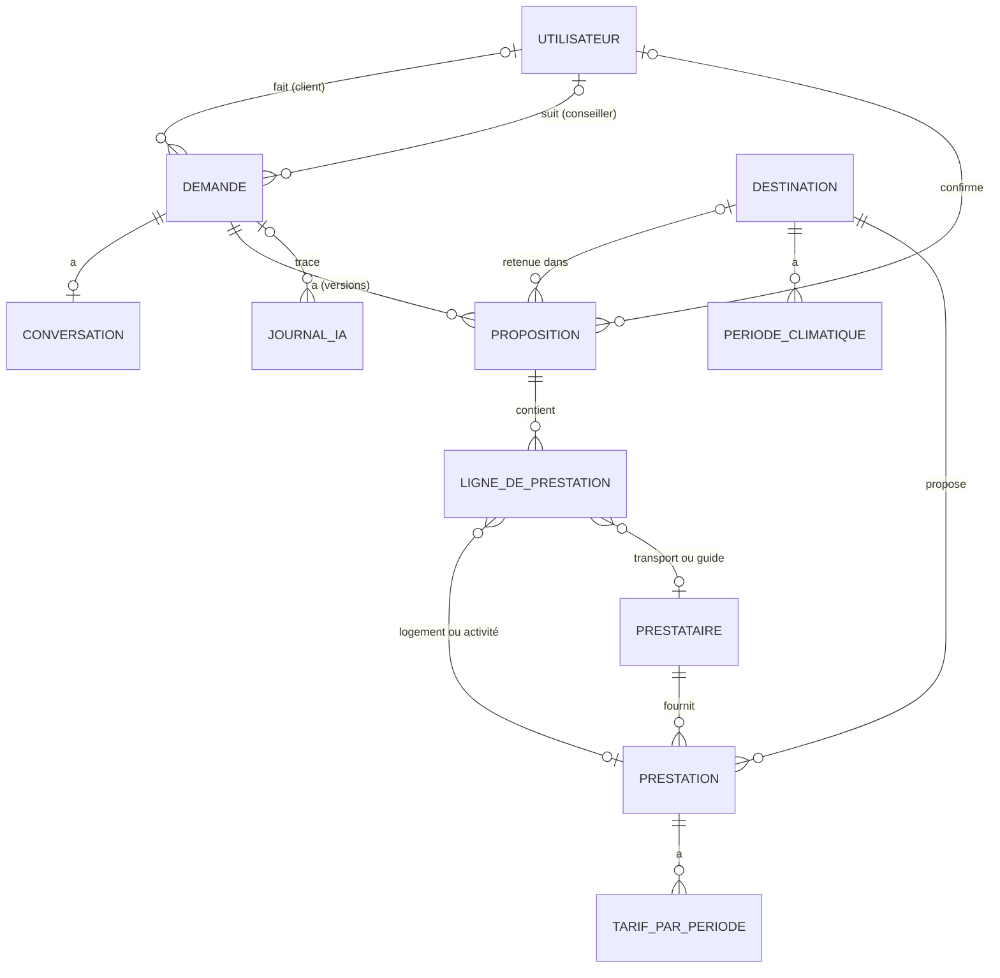

# ShortCut

Site web d'une agence de voyage avec un chatbot qui prépare des propositions sur mesure, et un backoffice pour les conseillers.
Le cahier des charges est dans [`cahier-des-charges.md`](cahier-des-charges.md).
Version : **v1.0.0** (gel du code le 23/10/2026).

| Dossier | Contenu | Stack |
| --- | --- | --- |
| `api/` | API, backoffice et appels à Claude | Symfony 7.4 (PHP 8.3), API Platform, EasyAdmin, Doctrine, PostgreSQL 16 |
| `site/` | Site public et widget du chatbot | React 19, TypeScript, Vite, TanStack Router, TanStack Query, TanStack Form, Zod, Tailwind CSS |

## Prérequis

- Docker Desktop (ou Docker Engine + Compose v2) : l'API PHP 8.3, Nginx, PostgreSQL 16 et le site React (Node 24, conteneur `front`) tournent dans des conteneurs
- `make` (déjà présent sur macOS et Linux ; sous Windows, lancer les commandes depuis Git Bash ou WSL)

Pas besoin d'installer PHP, Composer, PostgreSQL ni Node.js sur sa machine.

## Installation

```bash
git clone https://github.com/KJovene/ShortCut.git
cd ShortCut
make install
```

`make install` construit l'image PHP, démarre les conteneurs, installe les dépendances (Composer et npm dans Docker), crée `api/.env.local` à partir de l'exemple, applique les migrations et charge les données de démo.
Il reste à renseigner sa clé `ANTHROPIC_API_KEY` dans `api/.env.local`.

Les fichiers `.env.local` contiennent les secrets de chacun : ils ne sont **jamais commités**. La clé API Claude n'existe que côté API, le site ne la voit jamais.

### Windows : API lente

Sous Windows, le partage de fichiers entre la machine et Docker est très lent : chaque requête Symfony peut prendre plus de 10 s. `compose.windows.yaml` place `vendor/` et `var/` dans des volumes Docker (le code reste partagé). À faire une fois, avant ou après `make install` :

```bash
cp compose.windows.yaml compose.override.yaml   # lu automatiquement par Docker Compose, non versionné
make build && make down && make up
make composer c=install                         # remplit le volume vendor/
make cc
```

`api/vendor/` et `api/var/` de la machine ne sont alors plus utilisés par le conteneur : ajouter un paquet passe toujours par `make composer`, les logs se lisent avec `make sh` (`var/log/`). Pour l'autocomplétion de l'éditeur, `docker compose cp php:/app/vendor api/` recopie les dépendances sur la machine. macOS et Linux n'ont pas besoin de cette surcharge.

Si le site ne démarre plus ensuite (`EACCES ... node_modules/.vite-temp` dans `make site-logs`), les conteneurs avaient été lancés sans `make`, donc avec un autre utilisateur. Une seule fois :

```bash
docker compose run --rm --no-deps -u 0 --entrypoint sh front -c 'chmod -R a+rwX /app/node_modules'
make up
```

## Lancer le projet

```bash
make up     # API, base et site en arrière-plan
make dev    # suit les logs du site (Ctrl+C n'arrête pas le conteneur)
```

`make start` enchaîne les deux. Le conteneur `front` lance Vite avec le rechargement à chaud : modifier un fichier de `site/` suffit. Ses dépendances sont dans un volume Docker (`node_modules` n'apparaît pas dans `site/`), réinstallées automatiquement quand `package-lock.json` change. Pour ajouter un paquet : `make site-sh` puis `npm install <paquet>`. `make down` arrête et supprime les conteneurs. Les données de la base sont conservées dans un volume Docker.

| Adresse | Service |
| --- | --- |
| http://localhost:5173 | Site React. |
| http://localhost:5173/admin | Backoffice EasyAdmin des conseillers (aussi sur http://localhost:8000/admin). Sans session, il renvoie vers la page `/connexion` du site |
| http://localhost:8000/api | Documentation de l'API (API Platform) |
| `localhost:5433` | PostgreSQL (`shortcut` / `shortcut`, base `shortcut`), pour un client SQL. `make psql` ouvre une console. |

Le site appelle l'API en relatif (`/api/...`) : Vite redirige ces requêtes vers l'API, donc pas d'erreur CORS. Il redirige aussi `/uploads`, `/admin`, `/bundles`, `/sitemap.xml` et `/robots.txt` : le backoffice partage ainsi la session du site. NelmioCorsBundle autorise aussi `localhost` pour les appels directs.

Ports déjà pris sur votre machine ? Copier `.env.example` en `.env` à la racine et changer `API_PORT`, `POSTGRES_PORT` ou `ADMINER_PORT`. Le port du site se change avec `FRONT_PORT`.

Autres variables : `SITE_URL` (`api/.env`) est l'adresse du site, pour la redirection du backoffice vers `/connexion` et le plan du site. `site/.env.example`, à copier en `site/.env.local`, donne `API_PROXY_TARGET` (adresse de l'API pour le proxy Vite hors Docker) et `VITE_CALENDLY_URL` (prise de rendez-vous « Modifier le voyage » dans « Mon espace » ; vide, le bouton n'est pas affiché).

## Commandes

`make` affiche la liste complète. Les plus utiles :

| Commande | Effet |
| --- | --- |
| `make migration` | Génère une migration après modification des entités |
| `make migrate` | Applique les migrations |
| `make fixtures` | Recharge le jeu de données de démo (vide la base avant) |
| `make db-reset` | Recrée la base de zéro : suppression, création, migrations, fixtures |
| `make console c="debug:router"` | Lance une commande Symfony dans le conteneur |
| `make composer c="require symfony/mailer"` | Lance Composer dans le conteneur |
| `make db-ui` | Ouvre Adminer, l'interface web de la base : http://localhost:8080 (serveur `database`, utilisateur et mot de passe `shortcut`, base `shortcut`) |
| `make schema` | Régénère le diagramme complet de la base dans [`docs/schema.md`](docs/schema.md) à partir des entités Doctrine |
| `make openapi` | Exporte la documentation OpenAPI de l'API dans [`docs/openapi.yaml`](docs/openapi.yaml) (version interactive : http://localhost:8000/api/docs) |
| `make coverage` | Couverture des tests de l'API, classe par classe (détail dans `api/var/coverage/index.html`) |
| `make evaluer d="01 04"` | Évalue le chatbot sur les demandes test (toutes sans `d`) avec la vraie API Claude, **payant** ; rapport dans `api/evaluations/` |
| `make evaluer-proposition` | Génère la première proposition des demandes test (délai, durée du programme), vraie API Claude, **payant** ; programmes dans `api/evaluations/` |
| `make sh` | Shell dans le conteneur PHP |
| `make site-sh` | Shell dans le conteneur du site (npm) |
| `make logs s=php` | Logs d'un service (`php`, `nginx`, `database`, `front`, `adminer`) |

## Qualité du code

```bash
make check   # tout vérifier avant une pull request
make fix     # corriger automatiquement le style (PHP-CS-Fixer et Prettier)
```

`make check` lance le style et les types (`make lint`), PHPStan (`make stan`), les tests PHPUnit et Vitest (`make test`) et le build du site.
Avant les premiers tests qui utilisent la base, préparer la base de test avec `make db-test`.

## Modèle de données

Les entités sont dans `api/src/Entity`, les enums dans `api/src/Enum`. Le diagramme complet, avec toutes les colonnes, est dans [`docs/schema.md`](docs/schema.md) (`make schema` après chaque migration). Conventions :

- **Montants en centimes** (entiers) : `budgetCentimes`, `prixCentimes`, `totalCentimes`…
- **Périodes** : `debut` et `fin` (climat, tarifs) ou `dateDebut` et `dateFin` (demande, poste) en dates (`date_immutable`), avec une règle de validation qui refuse une fin avant le début ; `NoPeriodOverlap` refuse deux périodes de climat ou de tarif qui se chevauchent.
- **Listes libres** (envies, équipements, photos, hypothèses…) en colonnes JSON.
- Tarifs et climat gardent `saisiPar` et `modifieLe` pour repérer les périodes à mettre à jour.



| Entité | Rôle | Champs principaux |
| --- | --- | --- |
| `Utilisateur` | Client du site, conseiller ou administrateur du backoffice | e-mail, nom, prénom, téléphone, préférences, rôle (`ROLE_CLIENT`, `ROLE_CONSEILLER` ou `ROLE_ADMIN`, enum `Role`), mot de passe |
| `Demande` | Fiche remplie par l'agent Conversation | client, type de voyage, lieu ou zone, ville de départ, dates et flexibilité, nombre de jours, adultes, enfants et âges, budget (total ou par personne, transport inclus), envies (dont le climat souhaité), contraintes, langue (`fr` ou `en`), statut, prioritaire, conseiller, passage au conseiller (`motifTransmission`, `resumeTransmission`, `transmiseLe`) |
| `Conversation` | Messages entre le client et le chatbot | jeton de la conversation, messages, historique pour l'API Claude, début, fin, reprise par un conseiller |
| `Proposition` | Une version de proposition | version, type (première ou confirmée), statut (brouillon, envoyée, confirmée, acceptée, refusée, remplacée), lien public, destination, argumentaire, prestations retenues, combinaison (`choix`), options et date du choix (`optionsChoisiesLe`), fiche du moment (`exigences`), programme jour par jour, niveau de budget détaillé, totaux des trois niveaux, frais de dossier, hypothèses, envoyée le, confirmée par et le |
| `LigneDePrestation` | Poste chiffré d'une proposition | type (logement, transport, activité, guide), libellé, dates, quantité, prix estimé, prix confirmé |
| `Destination` | Destination du catalogue | pays, région, ville, nom, slug, accroche, description, points forts, photo et texte alternatif, types de voyage, zones, mois idéal, latitude et longitude (carte), temps de trajet par ville de départ, publiée, mise en avant |
| `PeriodeClimatique` | Climat d'une destination sur une période | début, fin, température moyenne, pluie |
| `Prestataire` | Hébergeur, transporteur, guide ou activités | nom, type, contact, conditions d'annulation, fourchettes de prix des transports |
| `Prestation` | Logement ou activité | type, nom, catégorie, description, capacité, chambres, équipements, accessibilité, durée, âge minimum, envies, photos |
| `TarifParPeriode` | Prix d'une prestation sur une période | début, fin, prix, unité (par nuit ou par personne), séjour minimum |
| `RegleDePrix` | Règles de prix de l'agence, modifiables par l'administrateur seul | marge (20 %), frais de dossier par type de voyage (`fraisDossierParTypeCentimes` : séjour 100 €, noces et circuit 150 €, groupe et entreprise 200 €), compris entre un minimum (100 €) et un maximum (200 €) |
| `JournalIA` | Trace de chaque appel à un agent IA | agent, demande, modèle, entrée, sortie, tokens consommés, durée (`dureeMs`) |

Index sur les champs filtrés : statut, conseiller et priorité des demandes, pays et publication des destinations, destination et type des prestations, capacité, et périodes (`destination` ou `prestation`, `debut`, `fin`) des climats et des tarifs.

Après une modification d'entité : `make migration`, relire le fichier créé dans `api/migrations/`, puis `make migrate`.

## Données de démo

`make fixtures` (ou `make db-reset` pour repartir d'une base vide) charge un catalogue fictif, défini dans `api/src/DataFixtures/Donnees/` pour que le PO puisse le relire et le modifier.

| Données | Contenu |
| --- | --- |
| Comptes | `admin@shortcut.test` (administrateur), `lea@shortcut.test` et `hugo@shortcut.test` (conseillers), `client@shortcut.test` (Camille), `julien@shortcut.test` et `sarah@shortcut.test` (clients). Mot de passe : `shortcut` |
| Destinations | 58 destinations dans 58 pays (Europe, Moyen-Orient, Afrique et océan Indien, Asie, Amériques, Océanie), une classe par grande région : climat sur les 12 mois de 2027, description, points forts, types de voyage, zones larges (« Europe », « Méditerranée », « Asie du Sud-Est »…) cherchées par le chatbot, photo. Une quinzaine sont mises en avant sur la carte de l'accueil |
| Prestataires | 44 : hébergeurs, transporteurs (fourchettes de vols depuis Paris, Lyon et Bordeaux vers chaque destination, transferts ou véhicule de circuit), guides et prestataires d'activités |
| Prestations | Environ 200 logements et 130 activités, avec capacité, accessibilité, envies, photos et tarifs par saison |
| Règles de prix | Marge 20 %, frais de dossier de 100 € (séjour), 150 € (noces, circuit) et 200 € (groupe, entreprise) |
| Demandes | 8 demandes réparties entre Léa, Hugo et une non attribuée, et entre trois clients. Camille a 3 voyages en cours, le maximum : Santorin (deux versions envoyées après une modification, à comparer sur « Ma proposition »), Marrakech (le client a demandé la confirmation : écran « Confirmer la proposition ») et Costa Rica (en discussion, transmise à un conseiller) |

Chaque destination a des vols depuis les trois villes de départ, au moins un logement pour une famille de quatre, un bloc de 20 places ou plus si elle propose les groupes, une salle de réunion si elle propose l'entreprise, et un logement romantique pour deux si elle propose les noces.

Périodes **volontairement non couvertes**, pour tester le passage au conseiller : aucun tarif en Islande d'octobre à avril, les Cabinas Drake Bay (Costa Rica) fermées en septembre et octobre, et des activités de saison (chiens de traîneau en Laponie de décembre à mars, ski au Tyrol de décembre à avril, trek au Népal hors mousson, croisière dans les fjords de mai à septembre…).

Les photos sont libres de droits (CC0 ou domaine public, crédits dans `api/fixtures/images/CREDITS.md`). Elles sont copiées dans `api/public/uploads/` (non versionné), servies par l'API sous `/uploads/…` et accessibles depuis le site grâce au proxy Vite.

## Sécurité et droits

Les droits sont vérifiés par l'API, jamais par le navigateur (`api/config/packages/security.yaml`).

| Profil | Rôle Symfony | Accès |
| --- | --- | --- |
| Administrateur | `ROLE_ADMIN` (hérite de `ROLE_CONSEILLER`) | Toutes les demandes, plus les règles de prix, les comptes et le Journal IA du backoffice |
| Conseiller | `ROLE_CONSEILLER` | Les demandes qui lui sont attribuées ; il voit aussi les demandes non attribuées pour les aiguiller (se les attribuer ou les confier à un autre conseiller), mais ne les traite qu'une fois attribuées |
| Client | `ROLE_CLIENT` | Inscription libre sur le site ; son profil (`/api/moi`), ses voyages (« Mon espace ») et ses conversations. Ni backoffice ni API du catalogue (403) |
| Chatbot | `ROLE_CHATBOT` | Porteur du jeton d'une conversation : uniquement la demande de cette conversation |

- **Comptes** (`SecuriteController`) : `POST /api/inscription` crée un compte client et le connecte ; `POST /api/connexion` (`email`, `motDePasse`) ouvre la session, qui sert aussi au backoffice ; `GET /api/moi` renvoie le profil (401 sans session) et `PATCH /api/moi` le modifie (changer d'e-mail ou de mot de passe exige `motDePasseActuel`) ; `/api/deconnexion` ferme la session. Une saisie invalide renvoie 422 et `{"erreurs": {"champ": "message"}}`. Contre le brute force (`login_throttling`) : 5 échecs par e-mail et adresse IP toutes les 15 minutes.
- **Mon espace** (`EspaceClientController`) : `GET /api/moi/demandes` liste les voyages du client avec leur proposition et leur conversation ; `DELETE /api/moi/demandes/{id}` supprime un voyage, avec sa conversation et ses propositions (409 pour un voyage accepté). Un client a au plus 3 voyages en cours, ni acceptés ni perdus (`Demande::VOYAGES_EN_COURS_MAX`).
- **Voter** : `DemandeVoter` (`DEMANDE_VOIR`, `DEMANDE_MODIFIER`, `DEMANDE_ATTRIBUER` pour l'aiguillage) s'applique à une demande, à sa conversation et à ses propositions. Dans un contrôleur : `$this->denyAccessUnlessGranted(DemandeVoter::VOIR, $demande)`.
- **Chatbot** : `POST /api/chat/conversations` ouvre une conversation et renvoie `{"jeton": "…", "demande": 12}`. Corps facultatif : `langue`, `questionnaire` (codes des réponses du questionnaire d'accueil : `typeDeVoyage`, `voyageurs`, `budget`) et `destination` (choisie sur la carte). Un client connecté est rattaché à la demande ; s'il a déjà 3 voyages en cours : 409. Les appels suivants envoient ce jeton dans l'en-tête `X-Conversation-Token` (pare-feu `chatbot`, sans session). Sans jeton valide : 401 ; demande d'un autre client : 403.
- **Limite de débit** (`api/config/packages/rate_limiter.yaml`) : par adresse IP, 20 requêtes par minute sur `/api/chat` et 10 nouvelles conversations par heure. Au-delà : 429 avec un message clair et l'en-tête `Retry-After`.
- **Messages du chatbot** : `POST /api/chat` avec le jeton et le corps JSON `{"message": "…"}` (2 000 caractères au plus, sinon 400). La réponse est diffusée en Server-Sent Events (`text/event-stream`) :

  | Événement | Données | Le site |
  | --- | --- | --- |
  | `texte` | `{"texte": "…"}` | ajoute ce morceau à la bulle de l'assistant |
  | `outil` | `{"nom": "chercher_destinations"}` | peut montrer que l'assistant cherche |
  | `demande` | `{"fiche": {…}, "recapitulatifConfirme": false, "langue": "fr"}` | met à jour le récapitulatif ; une fois confirmé, lance la proposition ; `langue` (`fr` ou `en`, US15) règle la langue des textes du chatbot |
  | `piste` | `{"type": "piste", "destination": {…}, "niveaux": {…}, "niveauConseille": "equilibre", "options": […], "avertissement": "…", …}` | carte de la piste retenue (`Chatbot/Piste`), sous le message de l'agent Recherche : dates, faits, les trois niveaux et leur total, le niveau conseillé, les options et leur prix |
  | `suggestions` | `{"type": "suggestions", "elements": [{"id": 12, "type": "logement", "nom": "…", "photos": […], …}]}` | logements et activités recommandés par l'agent Conversation (`consulter_catalogue`, `Chatbot/Suggestions`), en cartes cliquables sous son message ; chaque carte ouvre la fiche complète, sans prix |
  | `recapitulatif` | `{"type": "recapitulatif", "jeton": "…", "texte": "…", "totalCentimes": 574960, "options": […], …}` | carte du récapitulatif détaillé (`AgentRedaction::carte`) : lien vers « Ma proposition » ; s'il reste des options, boutons pour en ajouter une ou garder le voyage tel quel |
  | `erreur` | `{"erreur": "…"}` | affiche le message, déjà rédigé pour le client |
  | `fin` | `{"terminee": true}` | la réponse est complète ; `terminee` : la conversation n'attend plus rien du client (récapitulatif complet, conseiller), le site ferme la saisie |

  Les cartes sont gardées avec leur message (`Conversation::messages[].carte`), et leur texte (`contenu`) les remplace là où elles ne s'affichent pas : le chat les retrouve à la reprise depuis « Mon espace ».

  C'est une requête POST : côté site, lire le flux avec `fetch` et `response.body.getReader()`, pas avec `EventSource` (GET seulement).
- **Agent Conversation** (`api/src/Chatbot`) : Symfony appelle l'API Claude en streaming (`ClientClaude`, client HTTP `claude.client` qui porte la clé), exécute les outils demandés par le modèle (`Chatbot/Outil`, voir [`docs/outils.md`](docs/outils.md)) et rappelle Claude jusqu'à sa réponse finale (8 appels au plus par message). L'historique complet au format de l'API est gardé dans `Conversation::historique`, la conversation lisible dans `Conversation::messages`, chaque appel dans `JournalIA`. Le navigateur ne parle jamais à l'API Claude.
- **Agents et modèles** : Conversation (`claude-haiku-5-5`) dialogue avec le client et remplit la fiche ; Recherche (`claude-sonnet-5-5`) choisit la destination et la combinaison ; Rédaction (`claude-sonnet-5-5`, « Chiffrage et rédaction » dans le Journal IA) écrit le récapitulatif et la proposition. Leurs consignes sont dans `api/prompts/` (`conversation.md`, `recherche.md`, `redaction.md`), leurs 10 outils dans `api/src/Chatbot/Outil` ([`docs/outils.md`](docs/outils.md)).
- **Parcours du chat** : sur le site, le visiteur répond d'abord à un questionnaire de trois questions (type de voyage, voyageurs, budget), puis se connecte ou s'inscrit pour discuter avec l'assistant, qui reprend ses réponses. Le client confirme son récapitulatif ; l'agent Conversation répond d'une phrase, l'agent Recherche explique la piste et conseille un niveau, la carte `piste` donne les chiffres, puis la rédaction enregistre le récapitulatif détaillé (brouillon) et la carte `recapitulatif` en donne le lien. Le client le consulte tout de suite, dans le format de « Ma proposition » (`etat` `preparee`), et dans « Mon espace », tant que son conseiller ne lui a pas envoyé de version.
- **Options** : `retenir_combinaison` propose jusqu'à trois activités compatibles que le niveau conseillé ne contient pas, à leur prix de vente pour le groupe (`BudgetCalculator::options`, marge comprise), sauf si le budget est déjà insuffisant. Elles sont gardées sur la proposition (`Proposition::options`). Le client en ajoute (`choisir_options`) : la combinaison est recalculée avec elles en activités demandées, au niveau qu'il a choisi, et la rédaction met le récapitulatif à jour. Il n'en veut pas : rien n'est recalculé, et le chatbot ne les repropose plus (`Proposition::optionsChoisiesLe`).
- **Modification après une proposition** (US11, `NouvelleVersion`) : quand le client confirme un changement, la version suivante part de la précédente, qui garde sa combinaison (`Proposition::choix`) et la fiche du moment (`Proposition::exigences`). Dates, durée, voyageurs, budget, ville de départ ou contraintes : la même combinaison est recalculée sans appel à Claude. Autre type, autre zone, autres envies, ou combinaison refusée : l'agent Recherche repart de la précédente. La rédaction écrit la version suivante en brouillon : le conseiller la relit et l'envoie, et le client garde la précédente d'ici là (si aucune version ne lui a encore été envoyée, c'est son récapitulatif qui se met à jour). Sur un dossier déjà attribué sans proposition, la confirmation met seulement la fiche à jour : le conseiller prépare la première.
- **Page « Ma proposition »** : routes publiques, le lien unique (`jetonPublic`, 64 caractères) tient lieu d'accès. Le lien d'une version remplacée mène à la version qui fait foi (`versionDemandee` indique celle du lien).

  | Route | Effet |
  | --- | --- |
  | `GET /api/propositions/{jeton}` | la proposition : `etat` (`preparee` avant le premier envoi du conseiller, puis `estimee` ou `confirmee`), mention, destination, argumentaire, totaux des niveaux, hypothèses, programme, prestations et leurs points forts, postes (`lignes`, sans prix d'achat), `actions` possibles |
  | `GET /api/propositions/{jeton}/versions/{numero}` | une version reçue par le client, même remplacée (`versions` liste les numéros) |
  | `GET /api/propositions/{jeton}/versions/{numero}/pdf` | cette version en PDF (`PropositionPdf`, Dompdf), dans la langue de la demande |
  | `POST /api/propositions/{jeton}/demande-de-confirmation` | le client fait confirmer l'estimation : la demande passe « à confirmer » |
  | `POST /api/propositions/{jeton}/acceptation` | « J'accepte » sur la version confirmée : proposition et demande « acceptées » |

  Une action impossible renvoie 409 et `{"erreur": "…"}`, déjà rédigé pour le client.
- **Statuts** (`api/config/packages/workflow.yaml`) : deux machines à états du composant Workflow, `proposition` (brouillon, envoyée, confirmée, acceptée, refusée, remplacée) et `demande` (le pipeline : nouvelle, proposition envoyée, à confirmer, confirmée, acceptée, perdue). Les changements de statut passent par leurs transitions (`WorkflowInterface` avec `#[Target('demande')]`). Confirmer dans le backoffice crée une nouvelle version, qui remplace l'estimation (#209, #210).

## API du catalogue

Le catalogue est exposé avec API Platform (ticket #185). La documentation OpenAPI interactive est sur http://localhost:8000/api/docs ; `make openapi` l'exporte dans `docs/openapi.yaml`.

| Ressource | Adresse | Filtres de la liste |
| --- | --- | --- |
| Destinations | `/api/destinations` | `pays`, `ville`, `slug`, `publiee`, `miseEnAvant`, `mois` (AAAA-MM) avec `temperatureMin` / `temperatureMax`, `envie` |
| Prestataires | `/api/prestataires` | `nom`, `type` (`hebergeur`, `transporteur`, `guide`, `activite`) |
| Logements | `/api/logements` | `destination` (IRI), `destinationSlug`, `prestataire`, `categorie`, `capacite[gte]=4`, `chambres[gte]=2`, `accessible`, `envie` (tolère accents et pluriels), `mois` (au moins un tarif dans le mois) |
| Activités | `/api/activites` | les mêmes sauf `chambres`, plus `ageMinimum[lte]` et `dureeMinutes[lte]` |
| Tarifs | `/api/tarifs` | `prestation` (IRI), `unite`, `mois` |
| Destinations publiées (site public) | `/api/public/destinations`, `/api/public/destinations/{slug}` | `miseEnAvant`, `mois` avec `temperatureMin` / `temperatureMax` (liste sans pagination) |
| Frais de dossier (site public) | `/api/public/frais-de-dossier` | aucun : le barème en centimes par type de voyage |

- **Accès** : lecture, création et modification pour les conseillers connectés (session ouverte par `POST /api/connexion`) ; suppression d'une destination, d'un prestataire ou d'une prestation réservée à l'administrateur. Sans session : 401 ; compte client : 403. Les adresses `/api/public/…` sont en lecture seule et ouvertes à tous.
- **Formats** : JSON-LD (`application/ld+json`, avec `totalItems` et la pagination) ou JSON simple (`application/json`). Modification partielle en `PATCH` avec `application/merge-patch+json`.
- **Logements et activités** sont la même entité `Prestation` : l'adresse fixe le type (un champ `type` envoyé est ignoré).
- **Validation** : une entrée invalide renvoie 422 avec `violations`, un message en français par champ (`propertyPath`, `message`), y compris pour une valeur du mauvais type ou un filtre `mois` mal écrit.
- **Données publiques et internes** : groupes de sérialisation `destination:public` / `destination:interne`, `prestation:public` / `prestation:interne`. Les prestataires (contacts) et les tarifs (prix d'achat, avant marge) sont internes. Le site public lit `/api/public/destinations` : destinations publiées seulement (`PublieeExtension`), groupe `public:read`, avec des prix de vente « à partir de » et quelques exemples de logements et d'activités (`DestinationPubliqueNormalizer`), sans prestataire ni prix d'achat.
- **Montants** en centimes, dates au format `AAAA-MM-JJ`.

## Organisation du site

- `src/routes/` : une route par fichier (TanStack Router). `src/routeTree.gen.ts` est généré automatiquement par le plugin Vite, ne pas le modifier à la main.
- **Pages** : accueil (`/`), `/destinations` et `/destinations/{slug}`, `/types-de-voyages`, `/agence`, `/contact`, `/mentions-legales`, `/cgv`, `/confidentialite`, `/connexion`, `/inscription`, `/espace` (« Mon espace » : voyages en cours, reprise du chat, suppression d'un voyage), `/profil`, `/proposition/{jeton}` (« Ma proposition », avec son export PDF) et une page 404. Les textes des pages sont dans `src/features/pages/textes.ts` (« Mon espace », « Ma proposition » et le chat ont le leur), leurs photos dans `public/images/pages/` (crédits dans `CREDITS.md`). `/sitemap.xml` (pages publiques et destinations publiées) et `/robots.txt` sont générés par l'API (`ReferencementController`, à partir de `SITE_URL`).
- `src/lib/api.ts` : `requete(chemin, schémaZod, options?)` appelle l'API et valide la réponse avec Zod (à utiliser dans les `queryFn` de TanStack Query) ; `appelerApi(chemin, options)` renvoie la `Response` sans la lire (suppression, déconnexion). Le chemin s'écrit sans `/api` : `requete('/public/destinations', schéma)`.
- `src/lib/apparence.ts` : thème clair ou sombre, au choix dans l'en-tête ; sans choix, le site suit le réglage du système.
- `src/lib/cn.ts` : combine des classes Tailwind (`clsx` + `tailwind-merge`).
- L'alias `@/` pointe vers `src/`.

### Site en anglais (bouton FR | EN)

- **Langue du site** : `src/lib/langue.ts` (`useLangue()` dans un composant, `langueDuSite()` dans un loader ou un `head`). Français par défaut ; le choix du visiteur est gardé dans `localStorage` et met à jour `<html lang>`.
- **Textes fixes** : un fichier `textes.ts` par zone (`components/`, `features/pages/`, `features/espace/`, `features/chat/`, `features/proposition/`), sur le modèle `TEXTES[langue].cle`. Un nouveau texte s'ajoute dans les deux langues.
- **Chatbot** : il démarre dans la langue du site (`POST /api/chat/conversations` avec `{"langue": "en"}`), puis suit celle dans laquelle le client écrit (US15). La langue est gardée sur la demande (`Demande::langue`) : en anglais, les agents répondent en anglais, les textes du chiffrage (hypothèses, libellés de transport) sont présentés en anglais par `App\Texte\Anglais`, et la page « Ma proposition » et son PDF suivent cette langue.

## Règles d'équipe

- Pas de push direct sur `main` : pull request et relecture par un autre membre.
- Un ticket est terminé quand ses critères sont vérifiés en local sur `main` à jour, que le code est relu et fusionné, et que le PO l'a accepté.
- Tickets et sprints : [tableau Kanban](https://github.com/users/KJovene/projects/2/views/2).
