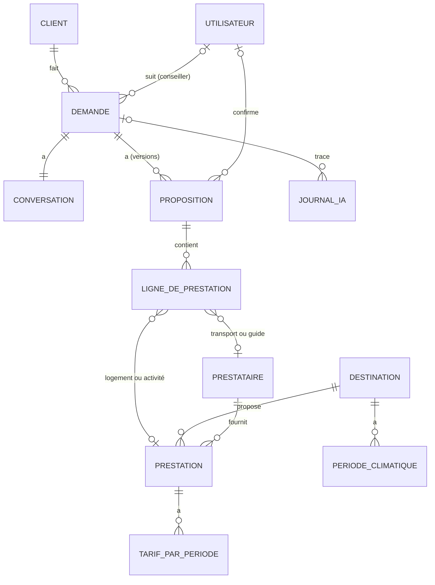

# ShortCut

Site web d'une agence de voyage avec un chatbot qui prépare des propositions sur mesure, et un backoffice pour les conseillers.
Le cahier des charges est dans [`cahier-des-charges.md`](cahier-des-charges.md).

| Dossier | Contenu | Stack |
| --- | --- | --- |
| `api/` | API, backoffice et appels à Claude | Symfony 7.4 (PHP 8.3), API Platform, EasyAdmin, Doctrine, PostgreSQL 16 |
| `site/` | Site public et widget du chatbot | React 19, TypeScript, Vite, TanStack Router, TanStack Query, TanStack Form, Zod, Tailwind CSS |

## Prérequis

- Docker Desktop (ou Docker Engine + Compose v2) : l'API PHP 8.3, Nginx, PostgreSQL 16 et le site React (Node 24, conteneur `front`) tournent dans des conteneurs
- `make` (déjà présent sur macOS et Linux)

Pas besoin d'installer PHP, Composer, PostgreSQL ni Node.js sur sa machine.

## Installation

```bash
git clone https://github.com/KJovene/ShortCut.git
cd ShortCut
make install
```

`make install` construit l'image PHP, démarre les conteneurs, installe les dépendances (Composer et npm dans Docker), crée `api/.env.local` à partir de l'exemple, applique les migrations et charge les données de démo.
Il reste à renseigner sa clé `ANTHROPIC_API_KEY` dans `api/.env.local`.

Les fichiers `.env.local` contiennent les secrets de chacun : ils ne sont **jamais commités**. La clé API Claude n'existe que côté API, le site ne la voit jamais.

### Windows : API lente

Sous Windows, le partage de fichiers entre la machine et Docker est très lent : chaque requête Symfony peut prendre plus de 10 s. `compose.windows.yaml` place `vendor/` et `var/` dans des volumes Docker (le code reste partagé). À faire une fois, avant ou après `make install` :

```bash
cp compose.windows.yaml compose.override.yaml   # lu automatiquement par Docker Compose, non versionné
make build && make down && make up
make composer c=install                         # remplit le volume vendor/
make cc
```

`api/vendor/` et `api/var/` de la machine ne sont alors plus utilisés par le conteneur : ajouter un paquet passe toujours par `make composer`, les logs se lisent avec `make sh` (`var/log/`). Pour l'autocomplétion de l'éditeur, `docker compose cp php:/app/vendor api/` recopie les dépendances sur la machine. macOS et Linux n'ont pas besoin de cette surcharge.

Si le site ne démarre plus ensuite (`EACCES ... node_modules/.vite-temp` dans `make site-logs`), les conteneurs avaient été lancés sans `make`, donc avec un autre utilisateur. Une seule fois :

```bash
docker compose run --rm --no-deps -u 0 --entrypoint sh front -c 'chmod -R a+rwX /app/node_modules'
make up
```

## Lancer le projet

```bash
make up     # API, base et site en arrière-plan
make dev    # suit les logs du site (Ctrl+C n'arrête pas le conteneur)
```

`make start` enchaîne les deux. Le conteneur `front` lance Vite avec le rechargement à chaud : modifier un fichier de `site/` suffit. Ses dépendances sont dans un volume Docker (`node_modules` n'apparaît pas dans `site/`), réinstallées automatiquement quand `package-lock.json` change. Pour ajouter un paquet : `make site-sh` puis `npm install <paquet>`. `make down` arrête et supprime les conteneurs. Les données de la base sont conservées dans un volume Docker.

| Adresse | Service |
| --- | --- |
| http://localhost:5173 | Site React. En développement, les devtools TanStack Query et Router s'affichent en bas de l'écran. |
| http://localhost:8000/api | Documentation de l'API (API Platform) |
| `localhost:5433` | PostgreSQL (`shortcut` / `shortcut`, base `shortcut`), pour un client SQL. `make psql` ouvre une console. |

Le site appelle l'API en relatif (`/api/...`) : Vite redirige ces requêtes vers l'API, donc pas d'erreur CORS. NelmioCorsBundle autorise aussi `localhost` pour les appels directs.

Ports déjà pris sur votre machine ? Copier `.env.example` en `.env` à la racine et changer `API_PORT` ou `POSTGRES_PORT`. Le port du site se change avec `FRONT_PORT`.

## Commandes

`make` affiche la liste complète. Les plus utiles :

| Commande | Effet |
| --- | --- |
| `make migration` | Génère une migration après modification des entités |
| `make migrate` | Applique les migrations |
| `make fixtures` | Recharge le jeu de données de démo (vide la base avant) |
| `make db-reset` | Recrée la base de zéro : suppression, création, migrations, fixtures |
| `make console c="debug:router"` | Lance une commande Symfony dans le conteneur |
| `make composer c="require symfony/mailer"` | Lance Composer dans le conteneur |
| `make db-ui` | Ouvre Adminer, l'interface web de la base : http://localhost:8080 (serveur `database`, utilisateur et mot de passe `shortcut`, base `shortcut`) |
| `make schema` | Régénère le diagramme complet de la base dans [`docs/schema.md`](docs/schema.md) à partir des entités Doctrine |
| `make sh` | Shell dans le conteneur PHP |
| `make site-sh` | Shell dans le conteneur du site (npm) |
| `make logs s=php` | Logs d'un service (`php`, `nginx`, `database`, `front`) |

## Qualité du code

```bash
make check   # tout vérifier avant une pull request
make fix     # corriger automatiquement le style (PHP-CS-Fixer et Prettier)
```

`make check` lance le style et les types (`make lint`), PHPStan (`make stan`), les tests PHPUnit et Vitest (`make test`) et le build du site.
Avant les premiers tests qui utilisent la base, préparer la base de test avec `make db-test`.

## Modèle de données

Les entités sont dans `api/src/Entity`, les enums dans `api/src/Enum`. Le diagramme complet, avec toutes les colonnes, est dans [`docs/schema.md`](docs/schema.md) (`make schema` après chaque migration). Conventions :

- **Montants en centimes** (entiers) : `budgetCentimes`, `prixCentimes`, `totalCentimes`…
- **Périodes** : `debut` et `fin` en dates (`date_immutable`), avec une contrainte qui refuse une fin avant le début.
- **Listes libres** (envies, équipements, photos, hypothèses…) en colonnes JSON.
- Tarifs et climat gardent `saisiPar` et `modifieLe` pour repérer les périodes à mettre à jour.



| Entité | Rôle | Champs principaux |
| --- | --- | --- |
| `Client` | Personne qui écrit au chatbot | prénom, nom, e-mail, téléphone, préférences |
| `Demande` | Fiche remplie par l'agent Conversation | type de voyage, lieu ou zone, dates et flexibilité, nombre de jours, températures min et max, adultes, enfants et âges, budget (total ou par personne, transport inclus), envies, contraintes, statut, conseiller |
| `Conversation` | Messages entre le client et le chatbot | jeton anonyme du navigateur, messages, début, fin, reprise par un conseiller |
| `Proposition` | Une version de proposition | version, type (première ou confirmée), statut, lien public, programme jour par jour, niveau de budget détaillé, totaux des trois niveaux, frais de dossier, hypothèses, confirmée par et le |
| `LigneDePrestation` | Poste chiffré d'une proposition | type (logement, transport, activité, guide), libellé, dates, quantité, prix estimé, prix confirmé |
| `Destination` | Destination du catalogue | pays, région, ville, slug, temps de trajet par ville de départ, points forts, description, photo, publiée, mise en avant |
| `PeriodeClimatique` | Climat d'une destination sur une période | début, fin, température moyenne, pluie |
| `Prestataire` | Hébergeur, transporteur, guide ou activités | nom, type, contact, conditions d'annulation, fourchettes de prix des transports |
| `Prestation` | Logement ou activité | type, nom, catégorie, capacité, équipements, accessibilité, durée, âge minimum, envies, photos |
| `TarifParPeriode` | Prix d'une prestation sur une période | début, fin, prix, unité (par nuit ou par personne), séjour minimum |
| `RegleDePrix` | Règles de prix de l'agence | marge (20 %), frais de dossier minimum (100 €) et maximum (200 €) |
| `PageDuSite` | Contenu modifiable d'une page du site | titre, slug, contenu, photos, titre et description pour le référencement, publiée, ordre dans le menu |
| `Utilisateur` | Conseiller ou administrateur du backoffice | e-mail, nom, rôle, mot de passe |
| `JournalIA` | Trace de chaque appel à un agent IA | agent, demande, modèle, entrée, sortie, tokens consommés |

Index sur les champs filtrés : statut et conseiller des demandes, pays et publication des destinations, destination et type des prestations, capacité, et périodes (`destination` ou `prestation`, `debut`, `fin`) des climats et des tarifs.

Après une modification d'entité : `make migration`, relire le fichier créé dans `api/migrations/`, puis `make migrate`.

## Données de démo

`make fixtures` (ou `make db-reset` pour repartir d'une base vide) charge un catalogue fictif, défini dans `api/src/DataFixtures/Donnees/` pour que le PO puisse le relire et le modifier.

| Données | Contenu |
| --- | --- |
| Comptes | `admin@shortcut.test` (administrateur), `lea@shortcut.test` et `hugo@shortcut.test` (conseillers). Mot de passe : `shortcut` |
| Destinations | Lisbonne, Marrakech, Santorin, Tenerife, Rome, Islande, Bali, Costa Rica : climat sur les 12 mois de 2027, description, points forts, photo |
| Prestataires | 15 : 7 hébergeurs, 3 transporteurs (fourchettes de vols depuis Paris, Lyon et Bordeaux, transferts), 2 guides, 3 prestataires d'activités |
| Prestations | 30 logements et 20 activités, avec capacité, accessibilité, envies, photos et tarifs par saison |
| Règles de prix | Marge 20 %, frais de dossier de 100 à 200 € |
| Pages du site | Accueil, types de voyages, l'agence, contact et pages légales (modèles « à valider ») |

Chaque type de voyage a au moins une combinaison possible : séjour (Tenerife, Lisbonne…), circuit (Islande, Costa Rica), groupe (résidences de 30 à 60 places), noces (Santorin, Bali), entreprise (salles de séminaire à Lisbonne, Marrakech et Rome).

Périodes **volontairement non couvertes**, pour tester le passage au conseiller : aucun tarif en Islande d'octobre à avril, et les Cabinas Drake Bay (Costa Rica) sont fermées en septembre et octobre.

Les photos sont libres de droits (CC0 ou domaine public, crédits dans `api/fixtures/images/CREDITS.md`). Elles sont copiées dans `api/public/uploads/` (non versionné), servies par l'API sous `/uploads/…` et accessibles depuis le site grâce au proxy Vite.

## Sécurité et droits

Les droits sont vérifiés par l'API, jamais par le navigateur (`api/config/packages/security.yaml`).

| Profil | Rôle Symfony | Accès |
| --- | --- | --- |
| Administrateur | `ROLE_ADMIN` (hérite de `ROLE_CONSEILLER`) | Toutes les demandes |
| Conseiller | `ROLE_CONSEILLER` | Les demandes qui lui sont attribuées ; il voit aussi les demandes non attribuées pour les aiguiller (se les attribuer ou les confier à un autre conseiller), mais ne les traite qu'une fois attribuées |
| Chatbot (client anonyme) | `ROLE_CHATBOT` | Uniquement la demande de sa propre conversation |

- **Voter** : `DemandeVoter` (`DEMANDE_VOIR`, `DEMANDE_MODIFIER`, `DEMANDE_ATTRIBUER` pour l'aiguillage) s'applique à une demande, à sa conversation et à ses propositions. Dans un contrôleur : `$this->denyAccessUnlessGranted(DemandeVoter::VOIR, $demande)`.
- **Chatbot** : `POST /api/chat/conversations` ouvre une conversation et renvoie un jeton. Les appels suivants envoient ce jeton dans l'en-tête `X-Conversation-Token` (pare-feu `chatbot`, sans session). Sans jeton valide : 401 ; demande d'un autre client : 403.
- **Limite de débit** (`api/config/packages/rate_limiter.yaml`) : par adresse IP, 20 requêtes par minute sur `/api/chat` et 10 nouvelles conversations par heure. Au-delà : 429 avec un message clair et l'en-tête `Retry-After`.

## Organisation du site

- `src/routes/` : une route par fichier (TanStack Router). `src/routeTree.gen.ts` est généré automatiquement par le plugin Vite, ne pas le modifier à la main.
- `src/lib/api.ts` : `apiFetch(chemin, schémaZod)` appelle l'API et valide la réponse avec Zod. À utiliser dans les `queryFn` de TanStack Query.
- `src/lib/cn.ts` : combine des classes Tailwind (`clsx` + `tailwind-merge`).
- L'alias `@/` pointe vers `src/`.

## Règles d'équipe

- Pas de push direct sur `main` : pull request et relecture par un autre membre.
- Un ticket est terminé quand ses critères sont vérifiés en local sur `main` à jour, que le code est relu et fusionné, et que le PO l'a accepté.
- Tickets et sprints : [tableau Kanban](https://github.com/users/KJovene/projects/2/views/2).
