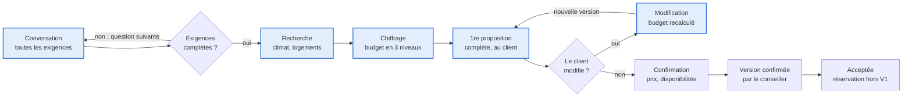
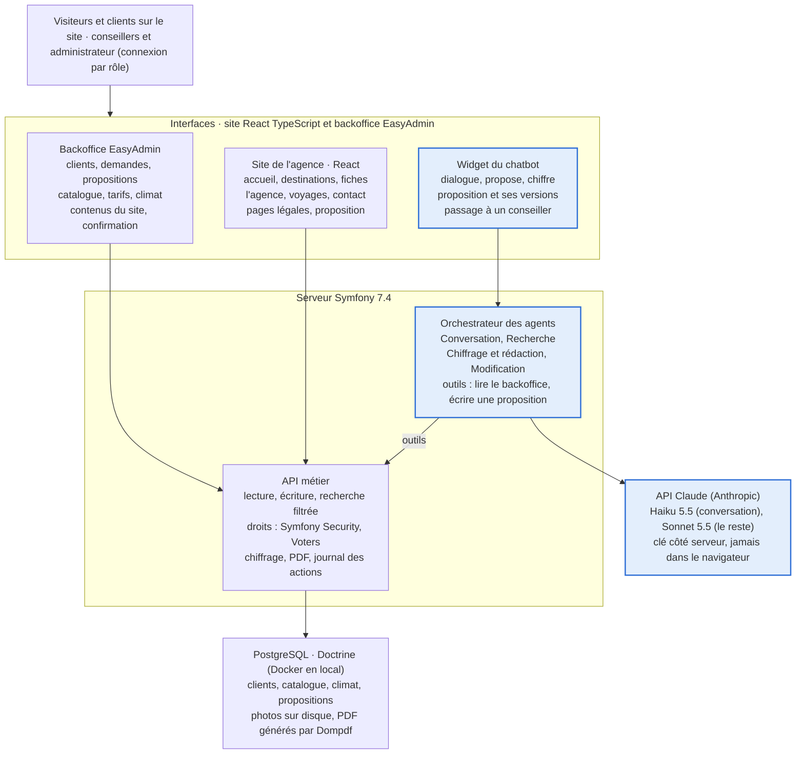
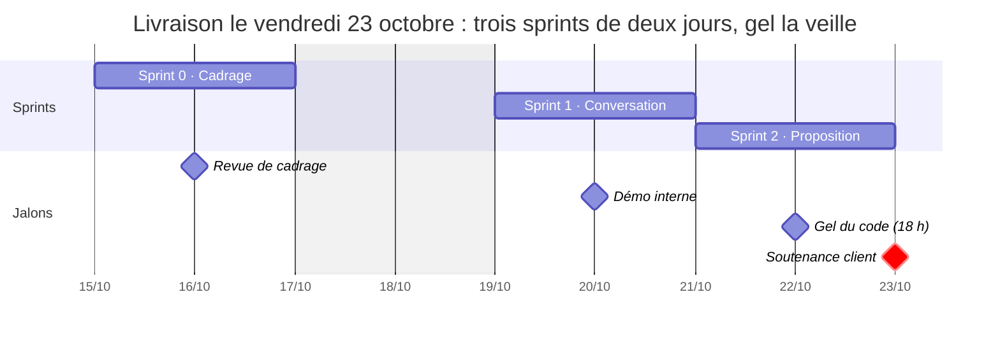

# Cahier des charges — ShortCut × Agence de voyage

15 octobre 2026 · Kévin

## 1. Contexte et objectifs

**Problème exprimé par l'agence.** Les demandes arrivent avec des envies, des contraintes et un budget, puis changent souvent. Chaque proposition est construite à la main, sans outil commun : un dossier complet prend aujourd'hui 13 jours à un conseiller. L'agence veut aller plus vite sans perdre la qualité du conseil, et demande ce que des agents IA devraient faire chez elle.

ShortCut livre le 23 octobre une V1 qui crée le site web de l'agence ; sur ce site, un chatbot client, alimenté par un backoffice qui centralise toutes les données de l'agence, recueille les exigences du voyageur et lui remet une première proposition complète et chiffrée dès la fin de la conversation ; le conseiller confirme ensuite prix et disponibilités.

**Principe de la solution.** L'IA propose, le conseiller confirme. Le chatbot construit une première proposition complète avec des hypothèses de budget explicites ; seule la proposition confirmée par un conseiller engage l'agence.

| Objectif | Indicateur observable | Aujourd'hui | Cible V1 (à valider avec l'agence) |
| --- | --- | --- | --- |
| Répondre immédiatement | Temps entre la fin de la conversation et la première proposition | Non mesuré | Moins de 2 minutes, sans intervention humaine |
| Raccourcir le dossier complet | Délai entre la première demande et la proposition confirmée | 13 jours par conseiller | 2 jours ouvrés au plus |
| Prendre en compte toutes les exigences | Part des critères exprimés (type de voyage, lieu, période, températures, budget, durée, voyageurs) respectés dans la proposition | Non mesuré | 100 % |
| Chiffrer juste | Écart entre le budget estimé et le prix confirmé par le conseiller | Non mesuré | Moins de 10 % sur les 10 demandes test |
| Absorber les changements | Temps pour obtenir une nouvelle version après une modification du client | Dossier repris à la main | Moins d'une minute dans le chatbot |
| Centraliser l'information | Part des demandes entrées par le chatbot et des données tenues dans le backoffice | Aucune donnée centralisée | 100 % |
| Garder la qualité du conseil | Part des propositions confirmées par un conseiller avant réservation | — | 100 % |

## 2. Notes du PO, reformulation et points inconnus

Le vrai problème n'est pas l'expertise des conseillers mais le temps perdu à chercher, ressaisir et recalculer à chaque changement de demande.

### Notes du PO

- Les propositions sur mesure prennent trop de temps à préparer.
- Une demande mélange trois natures d'information : des envies (floues), des contraintes (dates, voyageurs, mobilité, régime) et un budget.
- Les demandes changent souvent après une première proposition, ce qui oblige à tout refaire.
- L'agence n'a aucune base commune : chaque dossier repart de zéro, et un dossier complet prend 13 jours à un conseiller.
- L'agence attend de nous une réponse concrète sur le rôle des agents IA, pas une démonstration technologique.

### Reformulation de l'équipe

Comment remettre à chaque client, dès sa première conversation, une proposition complète qui respecte toutes ses exigences, tout en laissant au conseiller la confirmation finale ?

Notre réponse tient en trois briques :

1. **Un backoffice, source unique de vérité.** Il contient toutes les informations nécessaires : clients, destinations et leur climat par période, prestataires, logements et activités avec leurs tarifs par période, règles de prix de l'agence ; ce sont les conseillers qui la remplissent.
2. **Un chatbot client sur le site de l'agence.** Il dialogue avec le voyageur, prend en compte toutes ses exigences (lieu, période, températures, budget, nombre de jours, nombre de personnes, envies, contraintes), fait des hypothèses de budget, puis lui remet une première proposition complète. Le conseiller la reprend pour confirmer prix et disponibilités.
3. **Le site web de l'agence.** Créé de zéro en React TypeScript, il présente l'agence, ses types de voyages et ses destinations, et ouvre le chatbot depuis chaque page. Ses textes, photos et destinations se mettent à jour depuis le backoffice.

### Réponses de l'agence

L'agence a répondu à dix questions le 15 octobre ; la question sur le volume de demandes est retirée du périmètre.

| Question | Réponse de l'agence | Conséquence pour le projet |
| --- | --- | --- |
| Temps actuel de préparation d'une proposition | 13 jours pour un dossier complet, par conseiller | Point de départ des objectifs et du pitch |
| Canaux d'arrivée des demandes | Tout passe par le chatbot ; le conseiller aiguille au besoin | Le chatbot est l'unique porte d'entrée ; le backoffice permet d'aiguiller chaque demande |
| Types de voyages | Tous : séjours, circuits, groupes, voyages de noces, entreprise | Le chatbot identifie le type et adapte ses questions et la proposition |
| Canal du chatbot | Site web uniquement | Pas de messagerie, ni en V1 ni après |
| Fournisseur ou prestataire | Uniquement des prestataires | Une seule entité Prestataire (hébergement, transport, guide, activité) |
| Données existantes | Aucune ; tout est à recréer | Pas d'import : le backoffice démarre vide et les conseillers saisissent tout |
| API ou catalogues des prestataires | Non ; les conseillers récupèrent les informations pour chaque période | Saisie des tarifs et du climat période par période dans le backoffice |
| Règles de prix | Marge de 20 %, aucune commission, frais de dossier de 100 à 200 € selon le type de voyage (D21) | Formule de chiffrage fixée (section 4 et `docs/chiffrage.md`) |
| Format des propositions actuelles | Aucun modèle existant | ShortCut définit le format de la proposition |
| RGPD et hébergement | Hors périmètre pour le moment | Aucune exigence RGPD en V1 |

## 3. Carte des acteurs, informations, outils et décisions humaines

Six acteurs gravitent autour d'une demande ; toute demande entre par le chatbot, qui puise tout dans le backoffice, et le conseiller garde les décisions qui engagent l'agence.

### Acteurs

| Acteur | Rôle dans une demande | Informations apportées | Outils aujourd'hui | Outils en V1 |
| --- | --- | --- | --- | --- |
| Client voyageur | Exprime ses exigences, réagit à la proposition, accepte | Type de voyage, lieu, période, températures souhaitées, budget, nombre de jours et de personnes, envies, contraintes | E-mail, téléphone | Nouveau site de l'agence et son chatbot, proposition en ligne et en PDF |
| Chatbot client (IA) | Dialogue, chiffre et propose | Proposition complète, hypothèses de budget, versions successives | Aucun | Widget React présent sur chaque page du site |
| Conseiller voyage | Aiguille les demandes, collecte tarifs et climat par période, confirme, réserve | Expertise destination, tarifs et disponibilités des prestataires | Aucun outil commun | Backoffice |
| Responsable d'agence | Fixe les règles, supervise | Marge de 20 %, frais de dossier de 100 à 200 €, ton du chatbot | Aucun outil commun | Backoffice (rôle administrateur), contenus du site |
| Prestataires (hébergeurs, transporteurs, guides, activités) | Vendent et réalisent les prestations | Tarifs par période, disponibilités, conditions | Sites, e-mails, téléphone (sans API) | Fiches prestataires saisies par les conseillers |
| Équipe ShortCut | Conçoit, développe, forme | Site, modèle de données, prompts, parcours | — | Repo GitHub, tableau kanban |

### Décisions qui restent humaines

| Décision | Qui décide | Moment du parcours | Ce que l'IA fournit pour aider |
| --- | --- | --- | --- |
| À quel conseiller confier la demande ? | Conseiller | Dès l'arrivée de la demande | Fiche structurée et type de voyage |
| Le barème des frais de dossier par type de voyage | Responsable d'agence | Avant la mise en service, puis à chaque changement | Barème fixé en D21, modifiable dans le backoffice |
| Les prix et disponibilités sont-ils confirmés ? | Conseiller | Après la première proposition | Proposition, hypothèses de budget, conversation complète |
| Faut-il ajuster la proposition du chatbot ? | Conseiller | Avant la proposition confirmée | Fiche source de chaque prestation |
| La proposition confirmée peut-elle partir ? | Conseiller | Avant envoi | Version éditable, écarts avec la première proposition |
| Reprendre la conversation à la place du chatbot | Conseiller | À la demande du client ou sur alerte | Résumé de la conversation |
| Quels tarifs et quel climat saisir pour une période ? | Conseiller | En continu | Liste des périodes non couvertes |
| Réserver et payer | Conseiller | Après acceptation | Hors V1 |

## 4. Périmètre fonctionnel

La V1 couvre le site web de l'agence, un backoffice qui centralise toutes ses données et un chatbot client intégré au site qui s'appuie sur quatre agents IA pour remettre une première proposition complète ; le conseiller la confirme ensuite.

### Le site de l'agence

Le site est créé de zéro : neuf pages présentent l'agence et ses destinations, et chacune ouvre le chatbot, seule porte d'entrée des demandes. Textes, photos et destinations publiées se modifient dans le backoffice, sans redéploiement.

| Page | Contenu | Données utilisées |
| --- | --- | --- |
| Accueil | Accroche, recherche par envie et par mois, destinations mises en avant, accès au chatbot | Contenus du site, destinations mises en avant |
| Destinations | Liste filtrable par type de voyage (D24) | Destinations publiées, périodes climatiques |
| Fiche destination | Climat mois par mois, exemples de logements et d'activités, prix « à partir de », bouton « Construire mon voyage » | Destination, logements, activités, tarifs |
| Types de voyages | Séjours, circuits, groupes, voyages de noces, entreprise | Contenus du site |
| L'agence | Présentation, équipe de conseillers, engagements | Contenus du site |
| Contact | Coordonnées, horaires, accès au chatbot et à un conseiller | Contenus du site |
| Ma proposition | Proposition en ligne par lien unique, téléchargeable en PDF | Proposition |
| Pages légales | Mentions légales, CGV, confidentialité et cookies | Textes fournis par l'agence |
| Page introuvable | Message et retour vers les destinations | — |

Toutes les pages s'affichent sur mobile d'abord (360 à 1440 px), ont leur propre titre et description pour le référencement, et des textes alternatifs sur les photos. Si l'agence ne fournit pas ses textes légaux à temps, ShortCut livre des modèles marqués « à valider ».

### Les quatre agents IA derrière le chatbot

Le client ne voit qu'un seul interlocuteur ; derrière lui, chaque agent a une mission et ne lit que les données du backoffice.

| Agent | Mission | Entrée | Sortie | Contrôle humain |
| --- | --- | --- | --- | --- |
| Conversation | Dialoguer avec le client et recueillir toutes ses exigences | Messages du client | Fiche demande complète : lieu, période, températures souhaitées, budget, nombre de jours, voyageurs, envies, contraintes | Le conseiller peut reprendre la conversation |
| Recherche | Trouver les destinations, logements et activités compatibles | Fiche demande | Combinaisons qui respectent le climat aux dates, la capacité et les contraintes, chacune reliée à ses fiches sources | Règles fixées par le responsable |
| Chiffrage et rédaction | Calculer le budget et rédiger la première proposition | Combinaison retenue, règles de prix | Programme jour par jour, hébergements, activités, budget détaillé en trois niveaux avec ses hypothèses | Le conseiller confirme prix et disponibilités |
| Modification | Intégrer un changement demandé par le client | Message du client et proposition en cours | Nouvelle version, écarts surlignés, budget recalculé | Le conseiller confirme la version retenue |

### Ce que contient la première proposition

- La destination et pourquoi elle répond aux exigences : températures moyennes aux dates, temps de trajet, ambiance.
- Un programme jour par jour sur le nombre de jours demandé.
- Les hébergements adaptés au nombre de personnes, avec leurs photos.
- Les activités et prestataires choisis selon les envies et les contraintes.
- Un budget détaillé par poste, total et par personne, en trois niveaux : essentiel, équilibré, confort.
- La liste des hypothèses de budget : saison tarifaire, catégorie d'hébergement, transport inclus ou non, nombre de chambres.
- La mention « Première proposition, prix estimés, à confirmer par votre conseiller ».

### Comment le chatbot fait ses hypothèses de budget

Chaque niveau de budget applique les règles de prix de l'agence aux tarifs saisis dans le backoffice : marge de 20 % sur le coût des prestations, aucune commission, frais de dossier selon le type de voyage (séjour 100 €, voyage de noces et circuit 150 €, groupe et entreprise 200 €), ajoutés une fois par dossier. Le détail du calcul et trois exemples sont dans `docs/chiffrage.md`.

```latex
\text{Budget estimé} = \Big(\sum \text{hébergements} + \text{transports} + \sum \text{activités}\Big) \times 1{,}20 + \text{frais de dossier selon le type de voyage}
```

- **Budget donné par le client :** le niveau équilibré vise ce budget, les deux autres l'encadrent.
- **Aucun budget donné :** le chatbot calcule trois fourchettes et demande laquelle convient avant de détailler.
- **Budget insuffisant :** il propose des arbitrages chiffrés : moins de jours, autre catégorie, autre période ou destination voisine.
- **Poste sans tarif précis (vols, par exemple) :** il utilise la fourchette enregistrée dans le backoffice et affiche le poste comme estimé.

### Comment le chatbot s'adapte aux exigences du client

Le chatbot ne suit pas un formulaire fixe : chaque exigence change la question suivante et la proposition, et il résume au client ce qui a changé.

| Exigence exprimée | Question suivante du chatbot | Effet sur la proposition |
| --- | --- | --- |
| Type de voyage (séjour, circuit, groupe, voyage de noces, entreprise) | Questions propres au type : étapes d'un circuit, taille du groupe, date du mariage, objectif de l'entreprise | Programme adapté : plusieurs étapes pour un circuit, capacité de groupe, options pour les noces, salles de réunion pour l'entreprise |
| Lieu précis ou zone (« la Méditerranée ») | Ville de départ, envie de bouger ou de rester | Destinations de la zone uniquement, temps de trajet affiché |
| Températures souhaitées (« au moins 25 °C ») | Dates fixes ou flexibles | Destinations dont la moyenne aux dates convient, d'après le climat saisi par période |
| Budget | Total ou par personne, transport inclus ou non | Trois niveaux calculés autour du budget |
| Nombre de jours | Dates exactes ou période | Programme de cette durée exacte |
| Nombre de personnes et âges | Nombre de chambres, âge des enfants | Capacité respectée, activités adaptées à l'âge |
| Mobilité réduite | Type de besoin : plain-pied, ascenseur, fauteuil | Logements marqués accessibles uniquement |
| Envie floue (« dépaysement ») | Choix entre trois ambiances concrètes | Une piste par ambiance avant la proposition complète |
| Régime alimentaire ou allergie | Gravité de la contrainte | Contrainte notée et signalée au conseiller |
| Changement en cours de route | Confirmation du changement | Nouvelle version, écart résumé au client |

**Garde-fous.** Le chatbot annonce qu'il est une IA. Il n'utilise que les données du backoffice et cite la fiche de chaque prestation. Ses prix sont des estimations affichées comme telles ; il ne promet aucune disponibilité, ne réserve rien et ne prend aucun paiement. Si aucun tarif ou climat n'est saisi pour la période demandée, il le dit au client et transmet la demande à un conseiller. Il passe aussi la main sur demande du client. Chaque échange est tracé dans le journal.

### Les modules du backoffice

| Module | Contenu | Actions clés |
| --- | --- | --- |
| Clients | Coordonnées, préférences, historique de voyages | Rechercher, fusionner les doublons |
| Demandes | Type de voyage, fiche structurée, conversation complète, statut, conseiller | Aiguiller vers un conseiller, pipeline (nouvelle, proposition envoyée, à confirmer, confirmée, acceptée, perdue) |
| Propositions | Première proposition et versions, hypothèses de budget, frais de dossier, statut | Comparer, ajuster, confirmer, exporter en PDF |
| Destinations | Climat par période (températures moyennes, pluie), temps de trajet, points forts | Saisir une période, filtrer par mois et par température |
| Prestataires | Hébergeurs, transporteurs, guides, activités ; contact, conditions | Créer, filtrer par type, destination et envie |
| Logements et activités | Capacité, équipements, accessibilité, durée, âge minimum, tarifs par période, photos | Saisir les tarifs d'une période, voir les périodes non couvertes |
| Règles de prix | Marge (20 %), frais de dossier par type de voyage, entre 100 et 200 € | Modifiables par l'administrateur uniquement |
| Contenus du site | Textes des pages, photos, destinations mises en avant, textes légaux | Publier ou retirer une page ou une destination, modifiable par l'administrateur |

Le backoffice démarre vide : l'agence n'a aucune donnée existante et ses prestataires n'ont pas d'API. Les conseillers saisissent prestataires, logements, activités, tarifs et climat, période par période ; pour la démo, ShortCut crée un jeu de données fictif.

### Dans la V1, et après

| Dans la V1 (23 octobre) | Après la V1 |
| --- | --- |
| Backoffice EasyAdmin des huit modules, saisie par période | Rappels de mise à jour des tarifs par période |
| Chatbot client sur le site web, tous types de voyages | Espace client avec compte |
| Première proposition complète et chiffrée, en ligne et en PDF | Réservation, paiement, facturation |
| Aiguillage, confirmation par le conseiller, historique des versions | Application mobile |
| Rôles conseiller et administrateur | Conformité RGPD et choix d'hébergement des données |
| Journal des conversations et des actions IA | Statistiques avancées |
| Site de l'agence : neuf pages, contenus gérés dans le backoffice | Blog, avis clients, site multilingue, rendu côté serveur pour le référencement |

## 5. Parcours V1

Le client va seul de sa première question à une proposition complète et chiffrée ; le conseiller n'intervient qu'ensuite, pour confirmer prix et disponibilités.



*En bleu : le chatbot et ses agents IA, face au client. En blanc : le conseiller, qui confirme et engage l'agence.*

Deux boucles absorbent les changements : tant qu'une exigence manque, le chatbot pose la question suivante ; quand le client modifie la proposition, une nouvelle version recalculée lui revient en moins d'une minute.

### Choix d'organisation pour l'agence

- **Le chatbot est l'unique porte d'entrée** : un client qui appelle ou écrit est renvoyé vers le chatbot du site.
- **Le conseiller aiguille chaque nouvelle demande** vers le conseiller le plus adapté à la destination ou au type de voyage, et devient son référent.
- **Les conseillers construisent le catalogue** : chacun saisit les prestataires, tarifs et climat des destinations qu'il suit, période par période, en commençant par les plus demandées.
- **Un délai de confirmation annoncé au client** (cible proposée : 2 jours ouvrés, contre 13 jours aujourd'hui), affiché avec la première proposition.
- **Un conseiller de permanence** reprend les conversations quand un client le demande ou quand une période n'a pas de données.
- **Revue hebdomadaire des écarts** entre budget estimé et prix confirmé, pour corriger les tarifs saisis.

## 6. Modèle de données centralisé

Treize entités contiennent tout ce dont le chatbot a besoin pour proposer et chiffrer ; la demande relie le client, sa conversation, ses propositions et les prestations saisies par les conseillers.

| Entité | Champs clés | Relations |
| --- | --- | --- |
| Client | Nom, e-mail, téléphone, préférences (étiquettes) | Un client a plusieurs demandes |
| Conversation | Messages, début, fin, reprise par un conseiller (oui ou non) | Appartient à une demande |
| Demande | Type de voyage (séjour, circuit, groupe, noces, entreprise), lieu ou zone, dates et flexibilité, nombre de jours, températures souhaitées, adultes, enfants et âges, budget et portée (total ou par personne, transport inclus ou non), envies, contraintes, statut, conseiller attribué | Appartient à un client ; a une conversation et plusieurs propositions |
| Proposition | Version, type (première proposition ou confirmée), programme jour par jour, niveau de budget, total, total par personne, frais de dossier, hypothèses de budget, statut, confirmée par, date | Appartient à une demande ; contient des lignes de prestation |
| Ligne de prestation | Type (logement, transport, activité, guide), dates, quantité, prix estimé, prix confirmé | Relie une proposition à un logement, une activité ou un prestataire |
| Destination | Pays, région, ville, temps de trajet depuis les villes de départ, points forts, description et photo pour le site, publiée ou non | A des périodes climatiques, des logements et des activités |
| Période climatique | Début, fin, température moyenne, pluie, saisi par, date de mise à jour | Appartient à une destination |
| Prestataire | Nom, type (hébergeur, transporteur, guide, activité), contact, conditions d'annulation, fourchettes de prix des transports | Propose des logements et des activités |
| Logement ou activité | Nom, catégorie, capacité, équipements, accessibilité, durée, âge minimum, envies associées, photos | Appartient à une destination et à un prestataire ; a des tarifs par période |
| Tarif par période | Début, fin, prix par nuit ou par personne, séjour minimum, saisi par, date de mise à jour | Appartient à un logement ou une activité |
| Règle de prix | Marge (20 %), frais de dossier minimum (100 €) et maximum (200 €), frais par type de voyage | Appliquée à chaque chiffrage |
| Page du site | Titre, adresse (slug), texte, photos, titre et description pour le référencement, publiée, ordre dans le menu | Modifiée dans le backoffice, lue par le site |
| Utilisateur et journal IA | Rôle (conseiller, administrateur) ; pour chaque appel IA : agent, demande, entrée, sortie, date | Un utilisateur suit et confirme des demandes |

Aucune donnée n'existe aujourd'hui : les conseillers créent toutes les fiches, et chaque tarif ou climat garde la date de sa dernière mise à jour pour repérer les périodes à compléter.

## 7. Architecture technique et exigences non fonctionnelles

Deux projets suffisent pour la V1 : le site public en React TypeScript, et une application Symfony qui porte l'API, le backoffice EasyAdmin, la base PostgreSQL et l'appel à l'API Claude ; tout tourne en local, le déploiement étant reporté. Le chatbot public lit le backoffice et écrit des propositions uniquement à travers les outils du serveur, sans jamais voir les données d'un autre client.



*En bleu : les composants IA.*

L'orchestrateur ne lit jamais la base directement : il appelle l'API métier, qui applique les mêmes contrôles que pour un conseiller et écrit chaque appel dans le journal.

### Stack retenue

| Couche | Choix | Raison |
| --- | --- | --- |
| Site public et chatbot | React 19, TypeScript, Vite, React Router, Tailwind CSS | Pages rapides ; widget du chatbot réutilisé sur chaque page |
| API | Symfony 7.4 (PHP 8.3), API Platform | Routes REST documentées, validation et sérialisation prêtes à l'emploi |
| Backoffice | EasyAdmin (Symfony) | Listes, filtres et formulaires générés depuis les entités ; aucun écran codé à la main |
| Base de données | PostgreSQL 16 lancé avec Docker Compose | Base relationnelle standard, identique pour toute l'équipe |
| Accès aux données | Doctrine ORM, migrations et fixtures | Entités versionnées ; jeu de données fictif rechargeable en une commande |
| Authentification et droits | Symfony Security : session pour le backoffice, rôles conseiller et administrateur, Voters ; jeton anonyme et limite de débit (RateLimiter) pour le chatbot | Droits portés par l'API, jamais par le navigateur |
| IA | API Claude, Haiku 5.5 pour la conversation et Sonnet 5.5 pour la recherche, le chiffrage et la rédaction (D22), appelée depuis Symfony (HttpClient), réponses diffusées au fil de l'eau (Server-Sent Events) | Clé côté serveur ; premiers mots affichés vite |
| Fichiers | Photos sur le disque local (VichUploaderBundle), PDF générés depuis Twig (Dompdf) | Aucun service externe en V1 |
| Liaison site et API | Proxy Vite en local, NelmioCorsBundle | Aucun blocage CORS entre les deux projets |
| Déploiement | Hors périmètre pour l'instant ; démo en local | Décision D20 |

### Exigences non fonctionnelles

| Exigence | Cible V1 |
| --- | --- |
| Sécurité | Connexion obligatoire au backoffice ; chatbot limité en débit contre les abus ; droits par rôle vérifiés dans chaque route de l'API ; clé IA uniquement côté serveur |
| Traçabilité | 100 % des appels IA journalisés (agent, demande, date, durée) |
| Performance | Pages du site et du backoffice en moins de 2 s ; premiers mots du chatbot en moins de 5 s ; première proposition complète en moins de 2 minutes |
| Fiabilité de l'IA | Au moins 8 fiches correctes sur 10 demandes test ; zéro prestation absente du backoffice |
| Fiabilité du chiffrage | Chaque montant recalculable depuis les tarifs et les règles de prix ; écart estimé-confirmé inférieur à 10 % sur les demandes test |
| Ergonomie | Interface en français ; backoffice pensé pour un écran de 1280 px et plus ; chatbot utilisable sur mobile ; saisie d'une période de tarifs en moins de 2 minutes |
| Référencement | Titre et description propres à chaque page, adresses lisibles, plan du site (sitemap.xml) ; rendu côté serveur après la V1 |
| Accessibilité | Contrastes suffisants, navigation au clavier et textes alternatifs sur les photos, vérifiés sur chaque page du site |
| Maintenabilité | README d'installation ; prompts des agents versionnés dans le dépôt |

RGPD et choix d'hébergement des données sont hors périmètre pour le moment, à la demande de l'agence.

## 8. Backlog court et critères observables

Dix-neuf user stories, dont treize indispensables pour démontrer le parcours complet le 23 octobre ; chaque critère se vérifie en démo, sans interprétation.

| ID | User story | Priorité | Critère observable | Sprint |
| --- | --- | --- | --- | --- |
| US01 | En tant que conseiller, je me connecte et je vois mes demandes | Must | Un conseiller ne voit que ses demandes ; un administrateur les voit toutes | S1 |
| US02 | En tant que conseiller, je retrouve une fiche client et son historique | Must | Une recherche par nom retrouve le client, ses demandes et ses conversations | S1 |
| US03 | En tant que conseiller, je crée destinations, prestataires, logements et activités | Must | Fiche créée en moins de 2 minutes ; filtre des destinations par mois et température | S1 |
| US04 | En tant que conseiller, je saisis les tarifs et le climat d'une destination pour une période | Must | Une période saisie en moins de 2 minutes ; le chatbot l'utilise aussitôt ; les périodes non couvertes sont listées | S1 |
| US05 | En tant que client, je décris mon voyage et le chatbot recueille toutes mes exigences | Must | Sur 10 conversations test couvrant les 5 types de voyage, type, lieu, période, températures, budget, durée et voyageurs sont tous captés ; chaque exigence citée déclenche une question dédiée | S1 |
| US06 | En tant que conseiller, j'aiguille les demandes du chatbot et je reprends une conversation | Must | Chaque nouvelle demande s'attribue en un clic ; « parler à un conseiller » ou une période sans données crée une demande prioritaire | S1 |
| US07 | En tant que client, le chatbot me propose des destinations et logements compatibles | Must | Aucune proposition hors capacité, hors température demandée ou hors budget ; chaque prestation renvoie vers sa fiche | S2 |
| US08 | En tant que client, je vois des hypothèses de budget en trois niveaux | Must | Chaque niveau détaillé par poste, marge de 20 % et frais de dossier appliqués, hypothèses listées, total recalculable à la main | S2 |
| US09 | En tant que client, je reçois une première proposition complète | Must | Programme jour par jour de la durée demandée, hébergements, activités, budget ; en moins de 2 minutes ; mention « prix estimés » | S2 |
| US10 | En tant que conseiller, je confirme ou j'ajuste la proposition avant tout engagement | Must | Statut « à confirmer » dans le pipeline ; prix confirmés et frais de dossier saisis ; écart avec l'estimation affiché | S2 |
| US11 | En tant que client, je modifie ma demande dans le chatbot | Should | Nouvelle version en moins d'une minute, écarts surlignés, version précédente conservée | S2 |
| US12 | En tant que client, je télécharge ma proposition en PDF | Should | PDF aux couleurs de l'agence généré en un clic | S2 |
| US13 | En tant que responsable, je consulte le journal des conversations et des actions IA | Should | Chaque appel affiche l'agent, la demande, le client ou l'utilisateur et la date | S2 |
| US14 | En tant que responsable, je suis l'écart entre budgets estimés et prix confirmés | Could | Écart moyen affiché sur le tableau de bord | Après V1 si retard |
| US15 | En tant que client étranger, je dialogue en anglais avec le chatbot | Could | Conversation et proposition complètes en anglais | Après V1 si retard |
| US16 | En tant que visiteur, je découvre l'agence et j'ouvre le chatbot depuis n'importe quelle page | Must | Accueil, types de voyages, l'agence et contact accessibles depuis le menu ; bouton du chatbot sur chaque page ; affichage correct de 360 à 1440 px | S1 |
| US17 | En tant que visiteur, je parcours les destinations et leur climat par mois | Must | Liste filtrable par type de voyage, lue dans le backoffice (D24) ; une destination retirée disparaît du site sans redéploiement | S2 |
| US18 | En tant qu'administrateur, je modifie les textes et photos du site depuis le backoffice | Should | Une modification enregistrée est visible sur le site au rechargement de la page | S2 |
| US19 | En tant que visiteur, je consulte les mentions légales, les CGV et la politique de confidentialité | Must | Liens dans le pied de chaque page ; textes de l'agence ou modèles marqués « à valider » | S2 |

**Définition de terminé.** Une story est terminée quand son critère est vérifié en local sur main à jour, le code est relu par un autre membre et fusionné sur main, et le PO l'a acceptée en démo.

## 9. Organisation de l'équipe

L'équipe compte cinq rôles (hypothèse à ajuster à notre effectif réel) ; chaque livrable a un seul responsable, même quand plusieurs personnes y contribuent.

### Rôles

| Rôle | Responsabilités | Porte les livrables |
| --- | --- | --- |
| Product Owner (PO) | Relation avec l'agence, priorisation du backlog, acceptation des stories, pitch | Notes du PO, inconnus, pitch, registre des décisions |
| Scrum Master et UX | Rituels, tableau de tâches, déblocages, maquettes, parcours utilisateur | Carte des acteurs, parcours V1, maquettes |
| Développeur back-end et données | API Symfony, Doctrine, backoffice EasyAdmin, droits, outils de recherche du chatbot, chiffrage, PDF, jeu de données fictif | Modèle de données, API, backoffice |
| Développeur front-end | Site de l'agence en React TypeScript, widget du chatbot, page de la proposition, outillage du dépôt | Site web et widget du chatbot |
| Développeur IA | Prompts, orchestration des quatre agents, outils, évaluation sur les demandes test | Agents IA et grille d'évaluation |

Avec quatre personnes, le PO reprend le rôle de Scrum Master. Avec six, un second développeur rejoint le front-end.

### Rituels

| Rituel | Quand | Durée | Sortie |
| --- | --- | --- | --- |
| Daily | Chaque jour à 9 h 30 | 15 min | Blocages identifiés, tâches du jour attribuées |
| Sprint planning | Premier jour de chaque sprint, 10 h | 45 min | Stories engagées et découpées en tâches |
| Revue et démo | Dernier jour de chaque sprint, 16 h 30 | 30 min | Stories acceptées ou renvoyées |
| Rétrospective | Juste après la revue | 20 min | Une action d'amélioration pour le sprint suivant |
| Point agence | Vendredi 16 octobre, puis à la démo interne | 30 min | Réponses aux points inconnus, validation des choix |

### Outils de l'équipe

- **Code :** dépôt GitHub ShortCut avec deux dossiers, api (Symfony) et site (React), une branche par story, relecture obligatoire avant fusion sur main.
- **Tâches :** GitHub Projects, colonnes à faire, en cours, en relecture, terminé.
- **Maquettes :** Figma.
- **Communication :** un canal unique pour l'équipe, décisions recopiées dans le registre (section 13).

### Livrables et échéances

| Livrable demandé | Sections | Responsable | Échéance |
| --- | --- | --- | --- |
| Notes du PO, reformulation, points inconnus | 2 | PO | Oct 16, 2026 |
| Carte des acteurs, informations, outils, décisions humaines | 3 | Scrum Master et UX | Oct 16, 2026 |
| Parcours V1, backlog court, critères observables, choix d'organisation | 5 et 8 | Scrum Master et UX | Oct 16, 2026 |
| Site, backoffice et chatbot en local (gel du code à 18 h) | 4, 6, 7 | Développeur front-end | Oct 22, 2026 |
| Pitch client de trois minutes et registre des décisions | 12 et 13 | PO | Oct 22, 2026 |

## 10. Planning en sprints et découpage des tâches

Sept jours ouvrés séparent le lancement de la soutenance : trois sprints de deux jours, un gel du code le jeudi 22 à 18 h, et le vendredi 23 réservé à la répétition et au pitch.



Chaque sprint se termine par une démo ; une story non acceptée à la revue est soit terminée le lendemain matin, soit retirée du périmètre.

Le suivi se fait sur le [kanban GitHub](https://github.com/users/KJovene/projects/2/views/2) : 84 tickets, dont 19 user stories parentes (US14 et US15 en backlog) découpées en 65 tâches. Chaque ticket décrit son contexte, le travail à faire, ses critères d'acceptation, ses dépendances et son estimation ; la charge visée est de 14,5 h au plus par personne et par sprint.

### Sprint 0 · Cadrage et conception (jeudi 15 et vendredi 16)

Objectif : livrables de cadrage validés, API Symfony, site React et base PostgreSQL prêts en local, arborescence du site, données de démo et outils des agents définis. Charge totale : 47 h.

| Ticket | Tâche | User story | Responsable | Estimation |
| --- | --- | --- | --- | --- |
| [#163](https://github.com/KJovene/ShortCut/issues/163) | Relire les notes du PO et la reformulation | — | PO | 2 h |
| [#164](https://github.com/KJovene/ShortCut/issues/164) | Recueillir les réponses de l'agence | — | PO | 1 h |
| [#165](https://github.com/KJovene/ShortCut/issues/165) | Fixer la règle des frais de dossier | — | PO | 1 h |
| [#166](https://github.com/KJovene/ShortCut/issues/166) | Valider la carte des acteurs et des décisions | — | Scrum Master / UX | 2 h |
| [#167](https://github.com/KJovene/ShortCut/issues/167) | Maquetter le chatbot et la page de proposition | — | Scrum Master / UX | 4 h |
| [#168](https://github.com/KJovene/ShortCut/issues/168) | Maquetter les écrans métier du backoffice | — | Scrum Master / UX | 4 h |
| [#169](https://github.com/KJovene/ShortCut/issues/169) | Concevoir l'arborescence et les maquettes du site | — | Scrum Master / UX | 4 h |
| [#170](https://github.com/KJovene/ShortCut/issues/170) | Initialiser l'API Symfony et le site React | — | front-end | 3 h |
| [#171](https://github.com/KJovene/ShortCut/issues/171) | Assembler l'environnement Docker Compose | — | front-end | 2 h |
| [#172](https://github.com/KJovene/ShortCut/issues/172) | Créer les entités Doctrine et la première migration | — | back-end | 4 h |
| [#173](https://github.com/KJovene/ShortCut/issues/173) | Définir les rôles, Voters et limites du chatbot | — | back-end | 2 h |
| [#174](https://github.com/KJovene/ShortCut/issues/174) | Créer le jeu de données de démo | — | back-end, PO | 5 h |
| [#175](https://github.com/KJovene/ShortCut/issues/175) | Rédiger les 10 demandes test | — | PO | 3 h |
| [#176](https://github.com/KJovene/ShortCut/issues/176) | Spécifier la formule de chiffrage | — | IA, PO | 2 h |
| [#177](https://github.com/KJovene/ShortCut/issues/177) | Prototyper le prompt de conversation | — | IA | 4 h |
| [#178](https://github.com/KJovene/ShortCut/issues/178) | Spécifier les outils des agents | — | IA, back-end | 3 h |
| [#179](https://github.com/KJovene/ShortCut/issues/179) | Préparer le sprint planning du sprint 1 | — | Scrum Master / UX | 1 h |

### Sprint 1 · Backoffice, conversation et site (lundi 19 et mardi 20)

Objectif : les conseillers remplissent le catalogue, le chatbot recueille toutes les exigences d'un client puis transmet la demande ; le site et ses pages de présentation sont en place. Charge totale : 55 h.

| Ticket | Tâche | User story | Responsable | Estimation |
| --- | --- | --- | --- | --- |
| [#180](https://github.com/KJovene/ShortCut/issues/180) | Brancher la connexion au backoffice | [US01](https://github.com/KJovene/ShortCut/issues/144) | back-end | 2 h |
| [#181](https://github.com/KJovene/ShortCut/issues/181) | Protéger les routes de l'API et du backoffice | [US01](https://github.com/KJovene/ShortCut/issues/144) | back-end | 2 h |
| [#182](https://github.com/KJovene/ShortCut/issues/182) | Filtrer les demandes par conseiller dans EasyAdmin | [US01](https://github.com/KJovene/ShortCut/issues/144) | Scrum Master / UX | 2 h |
| [#183](https://github.com/KJovene/ShortCut/issues/183) | Construire la fiche client | [US02](https://github.com/KJovene/ShortCut/issues/145) | Scrum Master / UX | 3 h |
| [#184](https://github.com/KJovene/ShortCut/issues/184) | Rechercher un client par nom ou e-mail | [US02](https://github.com/KJovene/ShortCut/issues/145) | back-end | 1 h |
| [#185](https://github.com/KJovene/ShortCut/issues/185) | Exposer le catalogue avec API Platform | [US03](https://github.com/KJovene/ShortCut/issues/146) | back-end | 3 h |
| [#186](https://github.com/KJovene/ShortCut/issues/186) | Configurer le CRUD des destinations | [US03](https://github.com/KJovene/ShortCut/issues/146) | Scrum Master / UX | 2 h |
| [#187](https://github.com/KJovene/ShortCut/issues/187) | Configurer le CRUD des prestataires | [US03](https://github.com/KJovene/ShortCut/issues/146) | Scrum Master / UX | 1 h |
| [#188](https://github.com/KJovene/ShortCut/issues/188) | Configurer le CRUD des logements et activités | [US03](https://github.com/KJovene/ShortCut/issues/146) | Scrum Master / UX | 2 h |
| [#189](https://github.com/KJovene/ShortCut/issues/189) | Saisir une période en un seul formulaire | [US04](https://github.com/KJovene/ShortCut/issues/147) | front-end | 3 h |
| [#190](https://github.com/KJovene/ShortCut/issues/190) | Contrôler les chevauchements de périodes | [US04](https://github.com/KJovene/ShortCut/issues/147) | back-end | 2 h |
| [#191](https://github.com/KJovene/ShortCut/issues/191) | Intégrer le widget de conversation au site | [US05](https://github.com/KJovene/ShortCut/issues/148) | front-end | 4 h |
| [#192](https://github.com/KJovene/ShortCut/issues/192) | Créer la route de chat en streaming | [US05](https://github.com/KJovene/ShortCut/issues/148) | IA | 3 h |
| [#193](https://github.com/KJovene/ShortCut/issues/193) | Adapter les questions au type de voyage | [US05](https://github.com/KJovene/ShortCut/issues/148) | IA | 4 h |
| [#194](https://github.com/KJovene/ShortCut/issues/194) | Enregistrer la demande et la conversation | [US05](https://github.com/KJovene/ShortCut/issues/148) | IA, back-end | 3 h |
| [#195](https://github.com/KJovene/ShortCut/issues/195) | Évaluer le chatbot sur les demandes test | [US05](https://github.com/KJovene/ShortCut/issues/148) | PO | 2 h |
| [#196](https://github.com/KJovene/ShortCut/issues/196) | Afficher le pipeline et attribuer les demandes | [US06](https://github.com/KJovene/ShortCut/issues/149) | Scrum Master / UX | 3 h |
| [#197](https://github.com/KJovene/ShortCut/issues/197) | Transmettre la demande à un conseiller | [US06](https://github.com/KJovene/ShortCut/issues/149) | IA | 2 h |
| [#198](https://github.com/KJovene/ShortCut/issues/198) | Permettre la reprise de conversation | [US06](https://github.com/KJovene/ShortCut/issues/149) | back-end | 3 h |
| [#199](https://github.com/KJovene/ShortCut/issues/199) | Construire le gabarit du site | [US16](https://github.com/KJovene/ShortCut/issues/157) | front-end | 3 h |
| [#200](https://github.com/KJovene/ShortCut/issues/200) | Intégrer les pages accueil, voyages, agence et contact | [US16](https://github.com/KJovene/ShortCut/issues/157) | front-end | 4 h |
| [#201](https://github.com/KJovene/ShortCut/issues/201) | Animer la démo interne du sprint 1 | — | Scrum Master / UX | 1 h |

### Sprint 2 · Proposition, chiffrage et destinations (mercredi 21 et jeudi 22)

Objectif : un client obtient seul une première proposition complète et chiffrée, la modifie, puis un conseiller la confirme ; le site affiche les destinations du backoffice et ses pages légales. Charge totale : 53 h.

| Ticket | Tâche | User story | Responsable | Estimation |
| --- | --- | --- | --- | --- |
| [#202](https://github.com/KJovene/ShortCut/issues/202) | Coder les outils de recherche | [US07](https://github.com/KJovene/ShortCut/issues/150) | back-end | 4 h |
| [#203](https://github.com/KJovene/ShortCut/issues/203) | Choisir et justifier la combinaison | [US07](https://github.com/KJovene/ShortCut/issues/150) | IA | 3 h |
| [#204](https://github.com/KJovene/ShortCut/issues/204) | Gérer l'absence de combinaison | [US07](https://github.com/KJovene/ShortCut/issues/150) | IA | 1 h |
| [#205](https://github.com/KJovene/ShortCut/issues/205) | Coder le service de chiffrage | [US08](https://github.com/KJovene/ShortCut/issues/151) | back-end | 3 h |
| [#206](https://github.com/KJovene/ShortCut/issues/206) | Rédiger les hypothèses et arbitrages | [US08](https://github.com/KJovene/ShortCut/issues/151) | IA | 1 h |
| [#207](https://github.com/KJovene/ShortCut/issues/207) | Générer le programme jour par jour | [US09](https://github.com/KJovene/ShortCut/issues/152) | IA | 3 h |
| [#208](https://github.com/KJovene/ShortCut/issues/208) | Afficher la proposition dans le chat et en ligne | [US09](https://github.com/KJovene/ShortCut/issues/152) | front-end | 4 h |
| [#209](https://github.com/KJovene/ShortCut/issues/209) | Construire l'écran de confirmation | [US10](https://github.com/KJovene/ShortCut/issues/153) | Scrum Master / UX | 4 h |
| [#210](https://github.com/KJovene/ShortCut/issues/210) | Gérer les statuts et la version confirmée | [US10](https://github.com/KJovene/ShortCut/issues/153) | back-end | 2 h |
| [#211](https://github.com/KJovene/ShortCut/issues/211) | Recalculer une nouvelle version | [US11](https://github.com/KJovene/ShortCut/issues/154) | IA | 3 h |
| [#212](https://github.com/KJovene/ShortCut/issues/212) | Comparer deux versions | [US11](https://github.com/KJovene/ShortCut/issues/154) | front-end | 2 h |
| [#213](https://github.com/KJovene/ShortCut/issues/213) | Générer le PDF avec Dompdf | [US12](https://github.com/KJovene/ShortCut/issues/155) | back-end | 3 h |
| [#214](https://github.com/KJovene/ShortCut/issues/214) | Journaliser les appels IA | [US13](https://github.com/KJovene/ShortCut/issues/156) | IA | 2 h |
| [#215](https://github.com/KJovene/ShortCut/issues/215) | Intégrer la liste et la fiche des destinations | [US17](https://github.com/KJovene/ShortCut/issues/158) | front-end | 4 h |
| [#216](https://github.com/KJovene/ShortCut/issues/216) | Exposer les destinations publiées et les contenus | [US17](https://github.com/KJovene/ShortCut/issues/158) | back-end | 2 h |
| [#217](https://github.com/KJovene/ShortCut/issues/217) | Configurer le module Contenus du site | [US18](https://github.com/KJovene/ShortCut/issues/159) | Scrum Master / UX | 2 h |
| [#218](https://github.com/KJovene/ShortCut/issues/218) | Intégrer les pages légales | [US19](https://github.com/KJovene/ShortCut/issues/160) | Scrum Master / UX | 2 h |
| [#219](https://github.com/KJovene/ShortCut/issues/219) | Vérifier responsive, accessibilité et référencement | [US16](https://github.com/KJovene/ShortCut/issues/157) | Scrum Master / UX | 2 h |
| [#220](https://github.com/KJovene/ShortCut/issues/220) | Tester le parcours de bout en bout | — | PO, Scrum Master / UX | 3 h |
| [#221](https://github.com/KJovene/ShortCut/issues/221) | Relire les conversations de test | — | Scrum Master / UX | 2 h |
| [#222](https://github.com/KJovene/ShortCut/issues/222) | Geler le code et taguer la v1.0.0 | — | front-end | 1 h |

### Livraison (vendredi 23)

Objectif : une démo sans surprise et une soutenance tenue en trois minutes. Charge totale : 7 h.

| Ticket | Tâche | User story | Responsable | Estimation |
| --- | --- | --- | --- | --- |
| [#223](https://github.com/KJovene/ShortCut/issues/223) | Figer le scénario et les données de démo | — | PO, IA | 2 h |
| [#224](https://github.com/KJovene/ShortCut/issues/224) | Répéter le pitch deux fois | — | PO, front-end | 2 h |
| [#225](https://github.com/KJovene/ShortCut/issues/225) | Enregistrer la vidéo de secours | — | Scrum Master / UX | 1 h |
| [#226](https://github.com/KJovene/ShortCut/issues/226) | Mettre à jour le registre des décisions | — | PO | 1 h |
| [#227](https://github.com/KJovene/ShortCut/issues/227) | Présenter la soutenance | — | PO, Scrum Master / UX, back-end, front-end, IA | 1 h |

## 11. Risques et parades

Le risque principal est le délai de sept jours ouvrés : la parade est un périmètre Must strict et un gel du code le 22 octobre au soir.

| Risque | Probabilité | Impact | Parade |
| --- | --- | --- | --- |
| Le parcours complet n'est pas prêt le 23/10 | Moyenne | Fort | Stories Should et Could sacrifiées en premier ; démo enregistrée en secours |
| Le site prend du temps au détriment du chatbot | Moyenne | Fort | Neuf pages sur un gabarit unique ; backoffice généré par EasyAdmin pour libérer du temps ; le chatbot passe avant les finitions du site |
| Le site React et l'API Symfony communiquent mal | Moyenne | Moyen | Les deux projets tournent ensemble dès le sprint 0 avec Docker Compose ; proxy du site vers l'API ; contrats d'API documentés par API Platform |
| L'agence ne fournit pas ses textes et photos à temps | Forte | Faible | Textes et photos fictifs, modèles légaux marqués « à valider », remplacés depuis le backoffice |
| Le backoffice démarre vide et la saisie initiale prend du temps aux conseillers | Forte | Fort | Jeu de données de démo ; formulaires de saisie rapides ; commencer par les destinations les plus demandées |
| Une période demandée n'a ni tarif ni climat saisi | Moyenne | Moyen | Le chatbot le dit au client et transmet la demande ; liste des périodes non couvertes dans le backoffice |
| L'IA invente une prestation ou un prix | Moyenne | Fort | Agents limités au backoffice par des outils, source citée, prix marqués estimés |
| Le budget estimé s'écarte du prix réel | Moyenne | Fort | Tarifs datés par période, hypothèses affichées, revue hebdomadaire des écarts |
| Le client prend la première proposition pour un engagement | Moyenne | Moyen | Mention « prix estimés, à confirmer » sur chaque écran et dans le PDF ; délai de confirmation annoncé |
| Le chatbot répond mal à un client (promesse, ton, hors sujet) | Moyenne | Fort | Périmètre limité au voyage, passage à un conseiller en un clic, conversations relues en sprint 2 |
| Des demandes arrivent encore par téléphone ou e-mail | Moyenne | Moyen | Renvoi systématique vers le chatbot : lien dans les e-mails, message sur le répondeur |
| Réponses IA trop lentes en démo | Moyenne | Moyen | Affichage progressif des réponses, demandes de démo testées la veille |
| Les conseillers perçoivent l'IA comme un remplaçant | Moyenne | Fort | Message « l'IA propose, le conseiller confirme » ; démo sur un cas réel |
| Une absence bloque un pan du projet | Faible | Fort | Relecture croisée de chaque ticket, documentation minimale dans le README |
| Un site tiers déconnecte un utilisateur (déconnexion par lien) ou un jeton d'action du backoffice apparaît dans une adresse (D29) | Faible | Faible | Accepté en V1 ; passage en formulaires POST au backlog |

## 12. Pitch client de trois minutes

Le pitch suit cinq temps et environ 420 mots ; la démo en direct occupe la plus grande part, le PO parle et le développeur front-end pilote l'écran.

**0:00 – 0:30 · Le problème**

« Vous nous avez dit : nous passons trop de temps à préparer des propositions sur mesure. Une demande arrive avec des envies, des contraintes, un budget. Vous ouvrez trois fichiers Excel, deux dossiers Drive, vous rédigez. Puis le client change ses dates, et tout est à refaire. Résultat : 13 jours pour un dossier complet. Votre expertise n'est pas en cause. C'est votre temps qui s'évapore. »

**0:30 – 1:00 · Notre réponse**

« Nous avons construit trois choses. Votre nouveau site, qui présente vos destinations et vos voyages. Un backoffice où vos conseillers rassemblent enfin toutes vos informations : clients, destinations et leur climat, logements et tarifs, activités, règles de prix. Et un chatbot sur votre site, qui s'appuie sur ce backoffice pour remettre à chaque client une première proposition complète et chiffrée. La règle : l'IA propose, le conseiller confirme. »

**1:00 – 2:15 · La démo**

« Un couple écrit au chatbot : dix jours en mai, au soleil, au moins 25 degrés, 4 000 euros, pas de voiture. Le chatbot demande leur ville de départ et s'ils préfèrent bouger ou se poser. Il cherche dans votre backoffice les destinations à plus de 25 degrés en mai, les logements pour deux, les activités accessibles sans voiture. Moins de deux minutes plus tard, le client reçoit une proposition complète : programme sur dix jours, hôtels, activités, et trois budgets autour de ses 4 000 euros, chacun avec ses hypothèses. Il répond : finalement huit jours. Nouvelle version, budget recalculé, écarts surlignés. Côté agence, la demande arrive « à confirmer » : le conseiller vérifie les disponibilités, confirme les prix et envoie la version confirmée. »

**2:15 – 2:45 · Ce que vous y gagnez**

« Une première proposition en moins de deux minutes, à toute heure. Un dossier confirmé en deux jours au lieu de 13. Un chiffrage transparent, hypothèse par hypothèse. Et rien n'engage l'agence sans la confirmation d'un conseiller. »

**2:45 – 3:00 · La suite**

« Ce que nous vous demandons : trois dossiers réels anonymisés et une semaine d'essai avec deux conseillers. Nous mesurerons ensemble le temps gagné. Vos conseillers gardent le conseil ; nous leur rendons le temps. »

L'exemple du couple est un scénario de démo construit avec nos données fictives ; il sera remplacé par un cas fourni par l'agence s'il arrive avant le 22 octobre.

## 13. Registre des décisions

Vingt décisions sont prises au 15 octobre, toutes validées ou remplacées ; toute nouvelle décision s'ajoute en bas, et une décision changée passe en « Remplacée » avec un renvoi vers la nouvelle.

| ID | Date | Décision | Alternatives écartées | Justification | Décideur | Statut |
| --- | --- | --- | --- | --- | --- | --- |
| D01 | 15/10/2026 | L'assistant IA est interne, réservé aux conseillers, en V1 | Chatbot public pour les clients | Le conseil reste humain ; risque d'image trop fort pour une première version | Équipe, à confirmer par l'agence | Remplacée par D09 |
| D02 | 15/10/2026 | Un backoffice remplace Excel et Google Drive, avec import CSV | Garder Excel et brancher l'IA dessus | Une source unique est la condition pour que l'IA réponde juste | Équipe | Remplacée par D13 |
| D03 | 15/10/2026 | Quatre agents spécialisés plutôt qu'un chatbot généraliste | Un seul assistant conversationnel | Missions courtes, testables une par une, chacune suivie d'une validation | Équipe | Validée |
| D04 | 15/10/2026 | Validation humaine obligatoire avant tout export ou envoi | Envoi automatique des propositions | Qualité du conseil et responsabilité commerciale de l'agence | PO | Remplacée par D11 |
| D05 | 15/10/2026 | Stack : Next.js, Supabase (PostgreSQL, région UE), API Claude | Back-end séparé, base auto-hébergée | Authentification, base et stockage prêts en une journée ; hébergement européen | Équipe technique | Remplacée par D18 |
| D06 | 15/10/2026 | Démo sur un jeu de données fictif | Attendre les données réelles de l'agence | Aucune dépendance au calendrier de l'agence ; aucun risque RGPD | PO | Validée |
| D07 | 15/10/2026 | Sprints de deux jours, gel du code le 22/10 à 18 h | Un seul sprint d'une semaine | Deux revues avant la soutenance ; une journée entière pour stabiliser et répéter | Scrum Master | Validée |
| D08 | 15/10/2026 | Pas de connexion aux API fournisseurs en V1 | Intégrer un GDS ou une API hôtelière | Hors délai ; dépend de contrats que nous ne connaissons pas | Équipe, à confirmer par l'agence | Validée (confirmée par l'agence) |
| D09 | 15/10/2026 | Le chatbot IA s'adresse aux clients sur le site ; recherche et rédaction restent côté conseiller | Assistant interne réservé aux conseillers (D01) | Les clients décrivent leur voyage eux-mêmes ; le conseiller garde la validation de tout envoi | Kévin | Remplacée par D11 |
| D10 | 15/10/2026 | Le chatbot adapte ses questions et affiche des pistes indicatives selon les exigences du client | Chatbot limité à un questionnaire fixe, sans pistes | Le client voit tout de suite que sa demande est comprise ; prix « à partir de », la proposition définitive reste validée par un conseiller | PO | Validée |
| D11 | 15/10/2026 | Le chatbot remet au client une première proposition complète et chiffrée, sans validation préalable, marquée « prix estimés » ; le conseiller confirme ensuite | Validation humaine avant tout envoi (D04) ; recherche et rédaction côté conseiller (D09) | Réponse immédiate au client ; seule la proposition confirmée par un conseiller engage l'agence | PO | Validée |
| D12 | 15/10/2026 | Le backoffice est la seule source du chatbot : destinations et climat, tarifs par saison, activités, règles de prix | Météo et tarifs externes en temps réel | Chiffrage vérifiable et maîtrisé par l'agence ; aucune dépendance externe en V1 | Équipe | Validée |
| D13 | 15/10/2026 | Le backoffice démarre vide, sans import : les conseillers saisissent toutes les données, période par période | Import CSV des fichiers Excel (D02) | L'agence n'a aucune donnée existante et ses prestataires n'ont pas d'API | Agence | Validée |
| D14 | 15/10/2026 | Le chatbot du site web est l'unique porte d'entrée des demandes ; le conseiller les aiguille | Demandes par e-mail, téléphone ou messageries | Une seule source de demandes, toutes structurées dès l'arrivée | Agence | Validée |
| D15 | 15/10/2026 | Une seule entité Prestataire, sans distinction fournisseur | Fournisseurs et prestataires séparés | L'agence ne travaille qu'avec des prestataires | Agence | Validée |
| D16 | 15/10/2026 | Règles de prix : marge de 20 %, aucune commission, frais de dossier entre 100 et 200 € | Marge variable par prestataire | Règles données par l'agence ; la règle de choix des frais est fixée en D21 | Agence | Validée |
| D17 | 15/10/2026 | RGPD et hébergement des données hors périmètre de la V1 | Consentement et droits RGPD dès la V1 | Choix de l'agence ; à traiter avant une mise en production réelle | Agence | Validée |
| D18 | 15/10/2026 | PostgreSQL avec Prisma et Auth.js, sans Supabase ; déploiement reporté, démo en local | Supabase et Vercel (D05) | Choix de l'équipe : stack standard maîtrisée, aucune dépendance à un service hébergé pour la V1 | Équipe | Remplacée par D20 |
| D19 | 15/10/2026 | Le site web de l'agence est créé dans le projet : neuf pages, destinations lues dans le backoffice, pages légales, chatbot sur chaque page | Chatbot intégré à un site existant | Le site fait partie de la commande ; il est la vitrine et la seule porte d'entrée des demandes (D14) | Agence | Validée |
| D20 | 15/10/2026 | Stack : site en React TypeScript, API et backoffice en Symfony avec EasyAdmin, PostgreSQL via Doctrine ; déploiement reporté, démo en local | Next.js, Prisma et Auth.js (D18) | Choix de l'équipe ; EasyAdmin génère le backoffice depuis les entités et libère du temps pour le site | Équipe | Validée |
| D21 | 16/10/2026 | Frais de dossier selon le type de voyage : séjour 100 €, voyage de noces 150 €, circuit 150 €, groupe 200 €, entreprise 200 € | Selon le nombre de voyageurs ; au choix du conseiller avec une valeur par défaut | Le chatbot calcule seul des frais exacts dès la première proposition, simples à expliquer au client ; le prix ne bouge pas à la confirmation | Agence | Validée |
| D22 | 16/10/2026 | Modèle Claude Haiku 5.5 pour l'agent Conversation ; Claude Sonnet 5.5 conservé pour la recherche, le chiffrage et la rédaction | Sonnet 5.5 pour tous les agents | Test des 5 profils (#177) : mêmes résultats que Sonnet (10 exigences sur 10, aucun prix ni disponibilité annoncés, ton 5/5) pour 0,004 $ par conversation au lieu de 0,13 $ ; à revérifier avec les outils (#195) | Équipe | Validée |
| D23 | 23/10/2026 | Les règles de prix (marge, frais de dossier par type de voyage) se modifient dans le backoffice, par l'administrateur seul ; le site affiche le barème lu dans l'API | Barème figé en V1 ; frais écrits en dur dans le site | Exigence du cahier des charges (règles « modifiables par l'administrateur ») ; un seul barème pour le chiffrage et le site | Kévin | Validée |
| D24 | 23/10/2026 | La liste des destinations du site se filtre par type de voyage ; le filtre par mois et température est retiré de la page | Remettre les listes « mois » et « température » | Choix de l'équipe lors de la refonte de la charte DÉTOUR ; le climat reste lu dans le backoffice | Kévin | Validée |
| D25 | 23/10/2026 | Une demande marquée « perdue » passe la proposition reçue par le client en « refusée » | Bouton « Décliner » côté client ; supprimer le statut « refusée » | Pipeline et historique cohérents sans nouveau parcours client | Kévin | Validée |
| D26 | 23/10/2026 | Le questionnaire d'accueil envoie des codes à l'API ; « Plus de 3 000 € » ne fixe pas de budget cible, l'assistant propose trois fourchettes | Une valeur représentative par tranche ; un budget plancher | « Plus de 3 000 € » visait la même cible que « De 1 500 à 3 000 € » ; les codes ne dépendent plus des libellés affichés | Kévin | Validée |
| D27 | 23/10/2026 | Les préférences du client (étiquettes) sont saisies par le conseiller dans la fiche client | Calcul automatique depuis les demandes ; supprimer le champ | Exigence du cahier des charges ; le conseiller ne modifie pas les coordonnées du client | Kévin | Validée |
| D28 | 23/10/2026 | L'API renvoie ses erreurs sous une seule forme : « erreur » (message) ou « erreurs » (champ par champ) | Garder le format par défaut du pare-feu (« error ») | Le site lit une seule forme d'erreur | Kévin | Validée |
| D29 | 23/10/2026 | La déconnexion par lien et les jetons d'action du backoffice dans l'adresse sont acceptés en V1 | Formulaires POST partout dès la V1 | Risque faible, coût moyen le jour de la livraison ; inscrit au registre des risques | Kévin | Validée |
| D30 | 23/10/2026 | Les hypothèses de budget restent des phrases, écrites, reconnues et traduites depuis des gabarits communs | Hypothèses structurées (code et paramètres) | Une reformulation ne casse plus la confirmation ni la traduction, sans migrer les propositions existantes | Kévin | Validée |
| D31 | 23/10/2026 | En production, le site et l'API sont servis sur la même origine (proxy vers /api) | Domaines séparés, avec CORS | Aucune configuration CORS à maintenir ; le jeton du chatbot passe sans réglage | Kévin | Validée |
