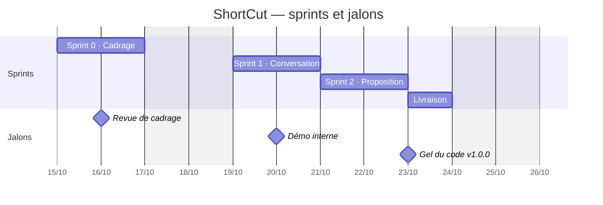
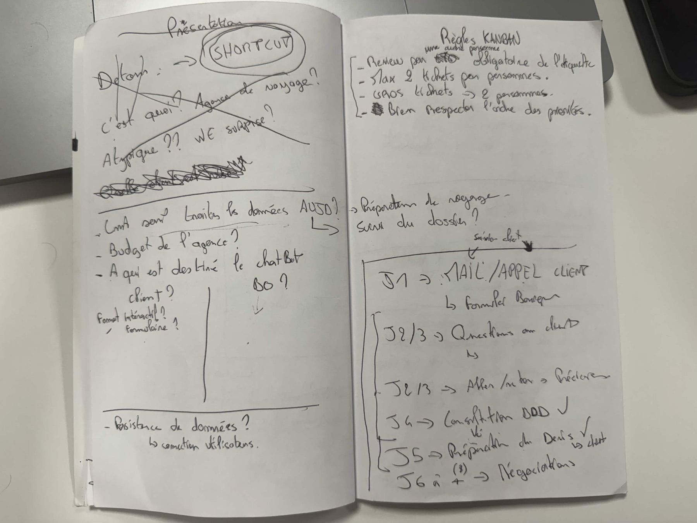
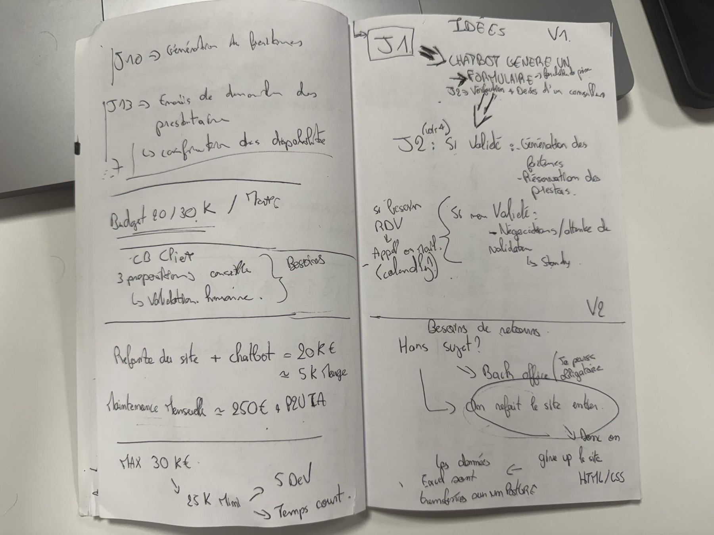
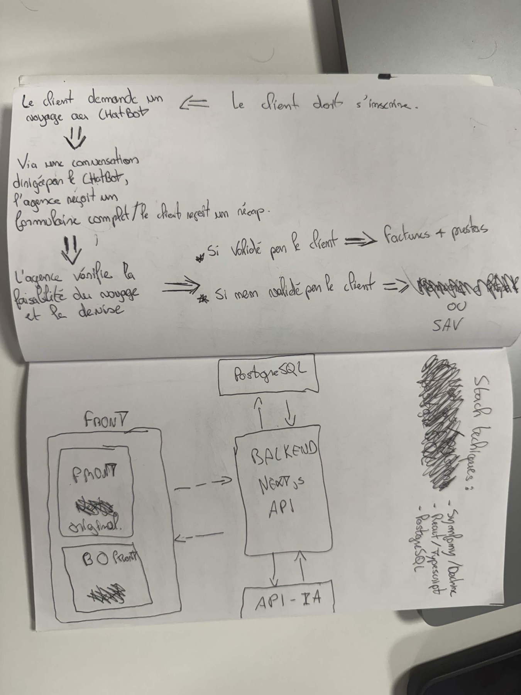
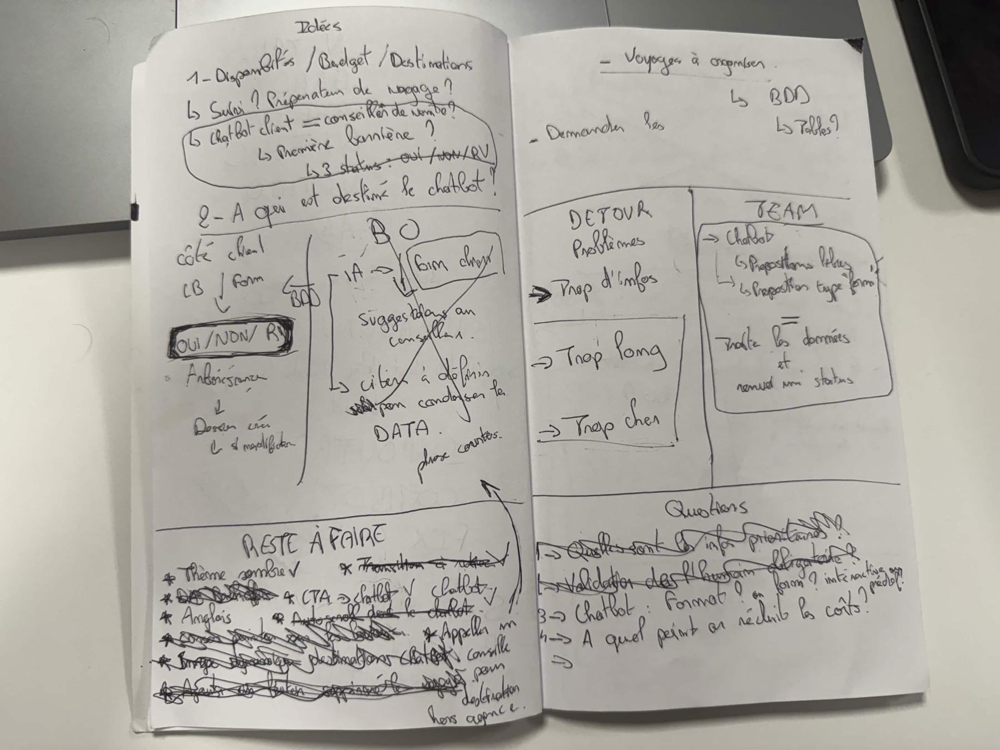
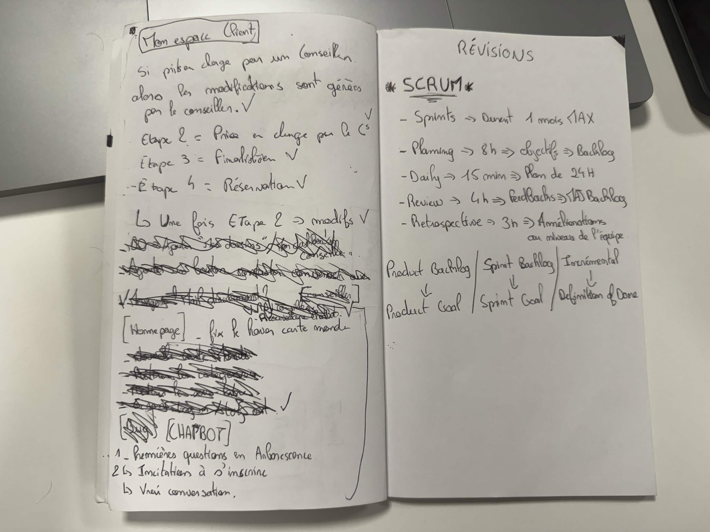

# Gestion de projet

Ce document retrace la gestion du projet ShortCut, du lancement le jeudi 15 octobre 2026 au gel de la v1.0.0 le vendredi 23 octobre 2026 : organisation de l'équipe, outils, choix faits en cours de route et avancement dans le GitHub Project. Les chiffres sont tirés du dépôt, des tickets et du tableau Kanban au 23 octobre 2026.

| Source                                                   | Où la trouver                                                                                                                                                                                          |
| -------------------------------------------------------- | ------------------------------------------------------------------------------------------------------------------------------------------------------------------------------------------------------ |
| Cahier des charges (13 sections, registre des décisions) | [`cahier-des-charges.md`](../cahier-des-charges.md)                                                                                                                                                    |
| Tableau Kanban                                           | [GitHub Project « ShortCut · V1 agence de voyage »](https://github.com/users/KJovene/projects/2/views/2)                                                                                               |
| Tickets et jalons                                        | [Issues](https://github.com/KJovene/ShortCut/issues) et [milestones](https://github.com/KJovene/ShortCut/milestones?state=all) du dépôt                                                                |
| Code et revues                                           | [Pull requests](https://github.com/KJovene/ShortCut/pulls?q=is%3Apr) du dépôt                                                                                                                          |
| Documentation technique                                  | [`README.md`](../README.md), [`docs/chiffrage.md`](chiffrage.md), [`docs/outils.md`](outils.md), [`docs/schema.md`](schema.md), [`docs/openapi.yaml`](openapi.yaml), [`api/prompts/`](../api/prompts/) |
| Carnet de l'équipe (notes manuscrites)                   | Section 8 et [`docs/images/carnet/`](images/carnet/)                                                                                                                                                   |

## 1. En chiffres

| Indicateur           | Valeur                                                                   |
| -------------------- | ------------------------------------------------------------------------ |
| Durée                | 7 jours ouvrés (15 → 23 octobre 2026)                                    |
| Sprints              | Sprint 0, Sprint 1, Sprint 2 (deux jours chacun) et Livraison            |
| User stories         | 19 (US01 à US19), toutes terminées                                       |
| Tickets              | 86, dont 84 terminés et 2 ouverts au gel (#222, #223)                    |
| Pull requests        | 65 ouvertes, 58 fusionnées, 7 fermées sans fusion (doublons ou reprises) |
| Commits              | 210 sur l'ensemble des branches, dont 96 fusions                         |
| Contributeurs        | 5 comptes GitHub                                                         |
| Décisions consignées | 41 (D01 à D41), dont 10 remplacées par une décision plus récente         |
| Tests automatisés    | 49 fichiers de tests PHPUnit (API), 16 fichiers de tests Vitest (site)   |

## 2. Organisation de l'équipe

### Rôles

Chaque livrable a un seul responsable, même quand plusieurs personnes y contribuent (cahier des charges, section 9).

| Rôle                            | Responsabilités                                                                                         |
| ------------------------------- | ------------------------------------------------------------------------------------------------------- |
| Product Owner                   | Relation avec l'agence, priorisation du backlog, acceptation des stories, pitch, registre des décisions |
| UX                              | Tableau de tâches, déblocages, maquettes, parcours utilisateur                                          |
| Développeur back-end et données | API Symfony, Doctrine, backoffice EasyAdmin, droits, chiffrage, PDF, jeu de données                     |
| Développeur front-end           | Site React TypeScript, widget du chatbot, outillage du dépôt                                            |
| Développeur IA                  | Prompts, orchestration des agents, outils, évaluation sur les demandes test                             |

### Contributions par compte GitHub (pull requests)

| Compte           | Pull requests ouvertes |
| ---------------- | ---------------------- |
| dubois-laurent   | 18                     |
| KJovene          | 15                     |
| ThomasMarcheschi | 13                     |
| MrDevaa          | 12                     |
| Cyril-Mathe      | 7                      |

## 3. Outils et conventions

### Le GitHub Project

Le tableau [« ShortCut · V1 agence de voyage »](https://github.com/users/KJovene/projects/2/views/2) est la source de vérité de l'avancement.

- **Colonnes :** À faire, En cours, En relecture, Terminé.
- **Champs personnalisés :** Sprint (Sprint 0, 1, 2, Livraison), Responsable (rôle), Estimation (heures).
- **Labels :** un par sprint (`sprint 0`, `sprint 1`, `sprint 2`, `livraison`), `backlog`, `user story`, et un par rôle (`PO`, `Scrum Master / UX`, `back-end`, `front-end`, `IA`).
- **Jalons GitHub (milestones), un par sprint, avec date d'échéance :**

| Jalon                                 | Échéance | Tickets fermés | Tickets ouverts au gel     |
| ------------------------------------- | -------- | -------------- | -------------------------- |
| Sprint 0 · Cadrage et conception      | 16/10    | 17             | 0                          |
| Sprint 1 · Backoffice et conversation | 20/10    | 29             | 0                          |
| Sprint 2 · Proposition et chiffrage   | 22/10    | 30             | 1 (#222, tag v1.0.0)       |
| Livraison                             | 23/10    | 4              | 1 (#223, scénario de démo) |

- **Ordre de la colonne « À faire » :** par sprint, chaque user story suivie de ses tâches.
- **Règles du tableau, notées dans le carnet de l'équipe (section 8, page 1) :** relecture obligatoire par une autre personne, deux tickets au plus par personne en même temps, les gros tickets confiés à deux personnes, l'ordre des priorités respecté.

### Rédaction des tickets

Le backlog a été réécrit deux fois le 15 octobre pour gagner en précision et supprimer les titres redondants ; le jeu final compte 19 user stories (#144 à #162) et 65 tâches (#163 à #227).

- **User story :** ticket parent titré `USxx · nom court`, label `user story`. Corps : la story, les critères observables, le découpage, le hors périmètre.
- **Tâche :** sous-ticket de sa story (39 liens parent-enfant sur 17 stories), titré par un verbe à l'infinitif, sans préfixe, titre unique. Corps en sections fixes : Contexte, À faire, Critères d'acceptation (cases à cocher), Notes techniques, Dépendances (« Bloqué par #n »), tableau Infos (sprint, responsable, estimation, story), Définition de terminé.
- **Taille :** tâches de 1 à 5 h, environ 14 h au plus par rôle sur un sprint de deux jours.
- **Définition de terminé :** critères vérifiés en local, code relu par un autre membre et fusionné, ticket accepté par le PO.
- **Demande de changement :** un changement demandé en cours de sprint donne un nouveau ticket (#263 « Après changement : Design du site global », #264 « Après changement : Adaptation du ton du chatbot ») plutôt qu'une modification silencieuse d'un ticket existant.

### Git et pull requests

- `main` reçoit le cahier des charges ; `dev` est la branche d'intégration : les 65 pull requests du projet visent `dev`.
- Une branche par story ou par correction : `feature/…`, `fix/…`, `hotfix/…`, `chore/…`, `data/…`.
- Pas de push direct sur `main` ; tout passe par une pull request (README, « Règles d'équipe »).
- Relecture automatique par GitHub Copilot sur 15 pull requests.
- Avant une pull request, `make check` lance le style (PHP-CS-Fixer, ESLint, Prettier), l'analyse statique (PHPStan), les types TypeScript, les tests (PHPUnit, Vitest) et le build du site. `make fix` corrige le style automatiquement.

### Environnement commun et documentation

- **Docker Compose et Makefile** dès le Sprint 0 (#170, #171) : `make install` installe tout, `make db-reset` recrée la base avec le jeu de démo, une variante Windows (`compose.windows.yaml`, PR #237) corrige la lenteur de l'API sous Windows.
- **Documentation générée depuis le code :** diagramme de la base (`make schema` → `docs/schema.md`) et contrat de l'API (`make openapi` → `docs/openapi.yaml`).
- **Évaluation du chatbot :** dix demandes test rédigées au Sprint 0 (#175) et commande `make evaluer` qui rejoue ces demandes sur l'API Claude réelle (#195).
- **Secrets :** la clé de l'API Claude reste dans `api/.env.local`, jamais versionné ; seuls des fichiers `.env.example` et `.env.local.example` sont dans le dépôt.

## 4. Historique jour par jour

| Jour       | Commits | PR fusionnées | Tickets fermés |
| ---------- | ------- | ------------- | -------------- |
| Jeu. 15/10 | 2       | 0             | 1              |
| Ven. 16/10 | 15      | 3             | 12             |
| Lun. 19/10 | 50      | 14            | 31             |
| Mar. 20/10 | 41      | 13            | 25             |
| Mer. 21/10 | 3       | 1             | 0              |
| Jeu. 22/10 | 75      | 20            | 5              |
| Ven. 23/10 | 24      | 7             | 10             |

### Sprint 0 · Cadrage et conception (jeudi 15 et vendredi 16)

**Jeudi 15.** Création du dépôt et du cahier des charges : notes du PO, reformulation, points inconnus, carte des acteurs, parcours V1, backlog court et critères observables. Les réponses de l'agence (#164) font basculer plusieurs choix dans la journée : le chatbot devient public et unique porte d'entrée des demandes (D09, D11, D14), le backoffice démarre vide sans import (D13), le site de l'agence entre dans le périmètre (D19), et la stack passe de Next.js et Supabase à Symfony, EasyAdmin, PostgreSQL et React (D05 → D18 → D20). Vingt décisions sont consignées. Le backlog, le tableau, les labels et les jalons sont créés.

**Vendredi 16.** Les règles de frais de dossier sont fixées par type de voyage (D21). Un test des cinq profils de clients compare deux modèles et retient Claude Haiku 5.5 pour la conversation, environ 30 fois moins cher pour le même résultat (D22). Côté code : initialisation de l'API et du site, Docker et Makefile, entités Doctrine et fixtures, formule de chiffrage (`docs/chiffrage.md`), prompt de conversation, outils des agents (`docs/outils.md`), connexion et rôles (PR #228 à #230). Treize des seize tâches du Sprint 0 sont fermées le vendredi ; les trois maquettes (#167 à #169) le sont le lundi.

### Sprint 1 · Backoffice, conversation et site (lundi 19 et mardi 20)

**Lundi 19.** Journée la plus productive en tickets (31 fermés, 14 PR fusionnées) : tarifs et climat par période (US04), liste des demandes par conseiller, design V1 du site et du backoffice, fiche client (US02), catalogue (US03), service de chiffrage (US08), chatbot en streaming, vitrine (US16), pages légales (US19). Une correction Docker pour Windows débloque les postes concernés.

**Mardi 20.** Évaluation automatique du chatbot sur les demandes test, recherche des combinaisons (US07), aiguillage des demandes (US06), première proposition en brouillon (US09), confirmation par le conseiller (US10), modification par le client (US11), PDF (US12), journal de l'IA (US13), destinations publiques (US17) et module Contenus (US18). La démo interne du Sprint 1 a lieu (#201). Le mardi soir, 15 des 17 user stories des sprints 1 et 2 sont fermées : le Sprint 2 a démarré en avance. Restent l'aiguillage (US06, fermée le 23) et les contenus modifiables (US18, fermée le 22).

### Sprint 2 · Proposition, chiffrage et destinations (mercredi 21 et jeudi 22)

**Mercredi 21.** Enrichissement du jeu de destinations (PR #260).

**Jeudi 22.** Pic d'intégration (75 commits, 20 PR) après deux demandes de changement : nouvelle charte graphique « DÉTOUR » du site (#263) et nouveau ton du chatbot et des textes (#264). La version anglaise (US15), prévue après la V1, est livrée (D36). Le chatbot exige désormais une connexion après trois questions d'accueil (D34), la température devient une envie et non plus une exigence (D35). Fiche demande, conversation et design du backoffice sont finalisés.

### Livraison (vendredi 23)

Dernières corrections du parcours (température, enregistrement des exigences, thème sombre, nettoyage), puis gel du code à 14 h 05 (commit `2bfd06a`, « Gel de la v1.0.0 : documentation à jour, tests et formatage corrigés »). Le gel, prévu le jeudi à 18 h (D07), est décalé au vendredi pour fusionner les dernières corrections (D40). Dix-neuf décisions (D23 à D41) sont ajoutées au registre pour aligner le cahier des charges sur ce qui a été construit. Les tickets de répétition du pitch (#224) et de vidéo de secours (#225) sont fermés.

## 5. Les choix structurants et leurs évolutions

Le registre des décisions (cahier des charges, section 13) consigne pour chaque choix sa date, les alternatives écartées, la justification, le décideur et son statut. Une décision n'est jamais effacée : elle passe en « Remplacée » avec un renvoi vers la nouvelle. Quatre fils montrent comment le projet a évolué.

| Sujet            | Évolution                                                                                                                                      | Raison du changement                                                                              |
| ---------------- | ---------------------------------------------------------------------------------------------------------------------------------------------- | ------------------------------------------------------------------------------------------------- |
| Rôle du chatbot  | D01 assistant interne → D09 chatbot client → D11 proposition envoyée sans relecture → **D32 proposition en brouillon relue par un conseiller** | Les réponses de l'agence, puis la volonté qu'un conseiller relise tout ce qui part chez le client |
| Stack technique  | D05 Next.js et Supabase → D18 PostgreSQL et Prisma → **D20 Symfony, EasyAdmin, React, PostgreSQL**                                             | Stack maîtrisée par l'équipe ; EasyAdmin génère le backoffice et libère du temps pour le site     |
| Données          | D02 import CSV des fichiers Excel → **D13 backoffice vide, saisi par période**                                                                 | L'agence n'a aucune donnée existante                                                              |
| Planning         | D07 gel le 22 à 18 h → **D40 gel et tag le 23**                                                                                                | Dernières corrections du parcours fusionnées le 23 au matin                                       |
| Périmètre ajouté | US15 (anglais) au backlog → **D36 français et anglais dès la V1**                                                                              | Clients étrangers servis dès la V1                                                                |
| Périmètre retiré | US18 Contenus modifiables → **D37 textes tenus dans le site** ; dialogue en direct avec un conseiller → **D39 recontact hors chatbot**         | Un module de moins le jour de la livraison ; hors délai pour la V1                                |
| Architecture IA  | D03 quatre agents → **D41 quatre agents logiques, trois agents Claude, chiffrage calculé par le serveur**                                      | Montants toujours recalculables, moins d'appels à l'IA                                            |

Les risques sont suivis dans la section 11 du cahier des charges, chacun avec sa probabilité, son impact et sa parade ; deux ont été ajoutés en cours de projet à la suite de décisions (D29, D34).

## 6. Avancement dans le GitHub Project

État du tableau au gel : 80 éléments en « Terminé », 1 en « En cours » (#222).

### Sprint 0 · Cadrage et conception — 16 tâches, 46 h

| Ticket | Tâche                                               | Responsable       | Estimation |
| ------ | --------------------------------------------------- | ----------------- | ---------- |
| #163   | Relire les notes du PO et la reformulation          | PO                | 2 h        |
| #164   | Recueillir les réponses de l'agence                 | PO                | 1 h        |
| #166   | Valider la carte des acteurs et des décisions       | Scrum Master / UX | 2 h        |
| #167   | Maquetter le chatbot et la page de proposition      | Scrum Master / UX | 4 h        |
| #168   | Maquetter les écrans métier du backoffice           | Scrum Master / UX | 4 h        |
| #169   | Concevoir l'arborescence et les maquettes du site   | Scrum Master / UX | 4 h        |
| #170   | Initialiser l'API Symfony et le site React          | front-end         | 3 h        |
| #171   | Assembler l'environnement Docker Compose            | front-end         | 2 h        |
| #172   | Créer les entités Doctrine et la première migration | back-end          | 4 h        |
| #173   | Définir les rôles, Voters et limites du chatbot     | back-end          | 2 h        |
| #174   | Créer le jeu de données de démo                     | back-end, PO      | 5 h        |
| #175   | Rédiger les 10 demandes test                        | PO                | 3 h        |
| #176   | Spécifier la formule de chiffrage                   | IA, PO            | 2 h        |
| #177   | Prototyper le prompt de conversation                | IA                | 4 h        |
| #178   | Spécifier les outils des agents                     | IA, back-end      | 3 h        |
| #179   | Préparer le sprint planning du sprint 1             | Scrum Master / UX | 1 h        |

### Sprint 1 · Backoffice et conversation — 7 user stories, 22 tâches, 55 h

| User story                                          | Tâches                                  | Fermée le |
| --------------------------------------------------- | --------------------------------------- | --------- |
| #144 US01 · Connexion et rôles                      | #180, #181                              | 19/10     |
| #145 US02 · Fiche client                            | #182, #183, #184                        | 19/10     |
| #146 US03 · Catalogue de l'agence                   | #185, #186, #187, #188                  | 19/10     |
| #147 US04 · Tarifs et climat par période            | #189, #190                              | 19/10     |
| #148 US05 · Recueil des exigences par le chatbot    | #191, #192, #193, #194, #195            | 20/10     |
| #149 US06 · Aiguillage et reprise des conversations | #196, #197, #198                        | 23/10     |
| #157 US16 · Vitrine de l'agence                     | #199, #200                              | 19/10     |
| —                                                   | #201 Animer la démo interne du sprint 1 | 20/10     |

### Sprint 2 · Proposition et chiffrage — 10 user stories, 21 tâches, 53 h

| User story                                         | Tâches                                                                         | Fermée le |
| -------------------------------------------------- | ------------------------------------------------------------------------------ | --------- |
| #150 US07 · Recherche des combinaisons compatibles | #202, #203, #204                                                               | 20/10     |
| #151 US08 · Budget en trois niveaux                | #205, #206                                                                     | 19/10     |
| #152 US09 · Première proposition au client         | #207, #208                                                                     | 20/10     |
| #153 US10 · Confirmation par le conseiller         | #209, #210                                                                     | 20/10     |
| #154 US11 · Modification par le client             | #211, #212                                                                     | 20/10     |
| #155 US12 · Export PDF                             | #213                                                                           | 20/10     |
| #156 US13 · Journal de l'IA                        | #214                                                                           | 20/10     |
| #158 US17 · Destinations sur le site               | #215, #216                                                                     | 20/10     |
| #159 US18 · Contenus modifiables                   | #217                                                                           | 22/10     |
| #160 US19 · Pages légales                          | #218, #219                                                                     | 19/10     |
| —                                                  | #220 Tester le parcours de bout en bout, #221 Relire les conversations de test | 23/10     |
| —                                                  | #222 Geler le code et taguer la v1.0.0                                         | en cours  |

### Livraison — 5 tâches, 7 h

| Ticket | Tâche                                    | État    |
| ------ | ---------------------------------------- | ------- |
| #223   | Figer le scénario et les données de démo | Ouvert  |
| #224   | Répéter le pitch deux fois               | Terminé |
| #225   | Enregistrer la vidéo de secours          | Terminé |
| #226   | Mettre à jour le registre des décisions  | Terminé |
| #227   | Présenter la soutenance                  | Terminé |

### Hors sprint

| Ticket | Contenu                                                             | État             |
| ------ | ------------------------------------------------------------------- | ---------------- |
| #161   | US14 · Suivi des écarts de chiffrage (backlog)                      | Terminé le 23/10 |
| #162   | US15 · Version anglaise du chatbot (backlog, avancée en V1 par D36) | Terminé le 22/10 |
| #263   | Après changement : design du site global                            | Terminé le 22/10 |
| #264   | Après changement : ton du chatbot et textes du site                 | Terminé le 22/10 |

## 7. Rétrospective : ce qui a marché, ce qui reste à améliorer

### Ce qui a marché

- **Un cadrage écrit avant le code.** Le cahier des charges et le backlog détaillé du Sprint 0 ont permis de fermer 15 des 17 user stories des sprints 1 et 2 dès le mardi 20, avant même le début du Sprint 2.
- **Des décisions traçables.** Chaque changement de cap a une ligne au registre, avec ses alternatives et sa raison ; le cahier des charges a été réaligné sur le produit au moment du gel.
- **Un environnement identique pour tous.** Docker Compose et le Makefile ont permis à chacun de lancer le projet avec une seule commande, y compris sous Windows.
- **Une IA mesurée, pas devinée.** Le choix du modèle (D22) et la qualité du chatbot reposent sur dix demandes test rejouables (`make evaluer`).
- **Des changements gérés par tickets.** Les demandes de changement du 22 octobre ont donné des tickets dédiés (#263, #264).

### Ce qui reste à améliorer

- **Relecture humaine peu tracée.** La règle d'équipe impose une relecture par un autre membre, mais aucune approbation n'est enregistrée sur les pull requests ; seules 15 PR portent une relecture automatique (Copilot). La prochaine fois : rendre l'approbation obligatoire par une règle de protection de branche.
- **`main` en retard sur `dev`.** La v1.0.0 est gelée sur `dev` ; la fusion vers `main` et le tag `v1.0.0` (#222) restent à faire.
- **Charge concentrée en fin de sprint.** Le jeudi 22 compte 75 commits et 20 PR, contre 3 commits le mercredi 21 : le changement de charte a été intégré tard. Fixer la charte graphique dès le Sprint 0 l'aurait évité.
- **Conventions de commits et de branches hétérogènes.** Gitmoji, préfixes `feat:`/`fix:` et messages libres coexistent, ainsi que `feature/` et `features/`. Une convention unique, vérifiée automatiquement, faciliterait la lecture de l'historique.
- **Pas d'intégration continue.** `make check` n'est lancé qu'en local ; un workflow GitHub Actions sur chaque pull request garantirait que rien n'est fusionné sans tests verts.
- **Écarts au cahier des charges découverts au gel.** Dix-neuf décisions ont été consignées le 23 octobre. Les noter au fil de l'eau, à chaque revue de sprint, garderait le document à jour en continu.

## 8. Annexe : le carnet de l'équipe

Les pages ci-dessous sont photographiées dans le carnet tenu pendant le projet. Elles montrent le travail fait avant et à côté des outils numériques : questions préparées pour l'agence, analyse du processus actuel, premières idées de parcours et d'architecture, règles du Kanban, suivi du reste à faire. Les transcriptions reprennent l'essentiel de chaque page ; les passages raturés sont omis. La dernière colonne relie chaque note à la décision ou au ticket qui l'a suivie.

### Page 1 — Nom du projet, questions à l'agence, règles du Kanban

| Note du carnet                                                                                                                                                                                                                                          | Suite donnée dans le projet                                                                                            |
| ------------------------------------------------------------------------------------------------------------------------------------------------------------------------------------------------------------------------------------------------------- | ---------------------------------------------------------------------------------------------------------------------- |
| « Détour → SHORTCUT » : choix du nom du projet, après plusieurs pistes raturées                                                                                                                                                                         | Nom du dépôt et du projet                                                                                              |
| Questions pour l'agence : comment sont traitées les données aujourd'hui, budget de l'agence, à qui est destiné le chatbot (client ou backoffice), format interactif ou formulaire, persistance des données et connexion des utilisateurs                | Points inconnus et réponses de l'agence (cahier des charges, section 2 ; ticket #164) ; décisions D09, D13, D14, D33   |
| Processus actuel d'un dossier : J1 mail ou appel du client, J2-J3 questions et allers-retours avec le client, J4 consultation de la base, J5 préparation du devis, J6 et plus négociations ; les étapes J4 et J5 sont cochées comme confiées au chatbot | Mesure de référence (13 jours par dossier) et parcours V1 (cahier des charges, sections 1 et 5)                        |
| **Règles du Kanban :** relecture obligatoire par une autre personne, deux tickets au plus par personne, les gros tickets confiés à deux personnes, l'ordre des priorités respecté                                                                       | Colonnes « En relecture » et ordre de la colonne « À faire » du GitHub Project (section 3) ; règles d'équipe du README |

### Page 2 — Processus actuel, budget du projet, idées V1 et V2

| Note du carnet                                                                                                                                                                                                   | Suite donnée dans le projet                                                                           |
| ---------------------------------------------------------------------------------------------------------------------------------------------------------------------------------------------------------------- | ----------------------------------------------------------------------------------------------------- |
| Fin du processus actuel : J10 génération des factures, J13 envoi des demandes aux prestataires et confirmation des disponibilités                                                                                | Mesure de référence : 13 jours par dossier complet et par conseiller                                  |
| Budget estimé : refonte du site et chatbot autour de 20 k€, plafond de 30 k€, maintenance mensuelle d'environ 250 € plus le coût de l'API IA ; cinq développeurs, délai court                                    | Pitch client (cahier des charges, section 12) ; choix d'un modèle économe pour la conversation (D22)  |
| Idées V1 : le chatbot produit un formulaire complet, un conseiller vérifie et chiffre ; si le client valide, factures et réservations ; sinon négociation ou attente ; rendez-vous en visio si besoin (Calendly) | Validation par un conseiller (D11 puis D32) ; lien de rendez-vous Calendly dans l'espace client (D39) |
| Idées V2 : un backoffice « obligatoire », le site refait en entier plutôt que garder le site HTML/CSS, les données Excel reprises dans un logiciel                                                               | Backoffice source unique (D12, D13) ; site de l'agence inclus dans le projet (D19)                    |

### Page 3 — Parcours client et première architecture

| Note du carnet                                                                                                                                                                                                                                                                       | Suite donnée dans le projet                                                                                                 |
| ------------------------------------------------------------------------------------------------------------------------------------------------------------------------------------------------------------------------------------------------------------------------------------ | --------------------------------------------------------------------------------------------------------------------------- |
| Parcours : le client s'inscrit, demande un voyage au chatbot ; la conversation produit un formulaire complet pour l'agence et un récapitulatif pour le client ; l'agence vérifie la faisabilité et chiffre ; si le client valide, factures et prestations, sinon service après-vente | Parcours V1 (cahier des charges, section 5) ; compte client obligatoire (D33, D34) ; brouillon relu par le conseiller (D32) |
| Architecture : un front (site et backoffice) qui appelle un back-end Next.js, relié à PostgreSQL et à l'API IA                                                                                                                                                                       | Première stack Next.js (D05, D18), remplacée par D20                                                                        |
| « Stack techniques » : Symfony et Doctrine, React et TypeScript, PostgreSQL                                                                                                                                                                                                          | Stack retenue (D20, cahier des charges, section 7)                                                                          |

### Page 4 — Questions de conception, retours d'équipe, reste à faire

| Note du carnet                                                                                                                                                                                                   | Suite donnée dans le projet                                                                                         |
| ---------------------------------------------------------------------------------------------------------------------------------------------------------------------------------------------------------------- | ------------------------------------------------------------------------------------------------------------------- |
| Idées : disponibilités, budget et destinations ; le chatbot client joue-t-il le rôle de conseiller de voyage ; trois issues possibles pour une demande : oui, non, rendez-vous ; un dossier créé puis modifiable | Statuts de la demande et de la proposition (US10, US11)                                                             |
| À qui est destiné le chatbot : côté client, conversation puis formulaire vers la base, l'IA alimente le backoffice ; les critères de combinaison restent à définir à partir de données concrètes                 | Chatbot client unique porte d'entrée (D09, D14) ; recherche des combinaisons (US07) ; jeu de données de démo (#174) |
| Problèmes relevés (« DÉTOUR ») : trop d'infos, trop long, trop cher                                                                                                                                              | Demandes de changement #263 (charte DÉTOUR) et #264 (ton du chatbot et textes)                                      |
| Retours de l'équipe : propositions libres ou de type formulaire ; le chatbot traite les données et renvoie un statut                                                                                             | Agents et outils du chatbot (`docs/outils.md`, D41)                                                                 |
| Questions ouvertes : quelles informations sont prioritaires, faut-il un formulaire de validation, quel format pour le chatbot (formulaire ou interactions prédéfinies), jusqu'où réduire les coûts               | Questionnaire d'accueil en trois questions (D26, D34) ; choix du modèle (D22)                                       |
| **Reste à faire,** coché au fil de l'eau : thème sombre, appels à l'action vers le chatbot, chatbot, anglais, appel d'un conseiller                                                                              | PR #290 (thème sombre), #262 à #286 (anglais, D36), transmission au conseiller (#197, D39)                          |

### Page 5 — Espace client, parcours du chatbot, rappels Scrum

| Note du carnet                                                                                                                                                                                                                                                                                     | Suite donnée dans le projet                                                                                                    |
| -------------------------------------------------------------------------------------------------------------------------------------------------------------------------------------------------------------------------------------------------------------------------------------------------- | ------------------------------------------------------------------------------------------------------------------------------ |
| Espace client : une fois la demande prise en charge par un conseiller, c'est lui qui gère les modifications ; étapes cochées : 2 prise en charge par le conseiller, 3 finalisation, 4 réservation                                                                                                  | Espace client et suivi des étapes (D33) ; confirmation par le conseiller (US10)                                                |
| Accueil : corriger la carte du monde                                                                                                                                                                                                                                                               | Page d'accueil du site (US16)                                                                                                  |
| Chatbot : 1. premières questions en arborescence, 2. invitation à s'inscrire, 3. vraie conversation                                                                                                                                                                                                | Trois questions d'accueil, puis connexion, puis conversation libre (D34)                                                       |
| Rappels Scrum : sprints d'un mois au plus ; planning (objectifs, backlog), daily de 15 minutes (plan des 24 h), revue (retours, mise à jour du backlog), rétrospective (améliorations de l'équipe) ; product backlog, sprint backlog, incrément ; product goal, sprint goal, définition de terminé | Cadre des rituels adapté à des sprints de deux jours (section 2) ; définition de terminé écrite dans chaque ticket (section 3) |
